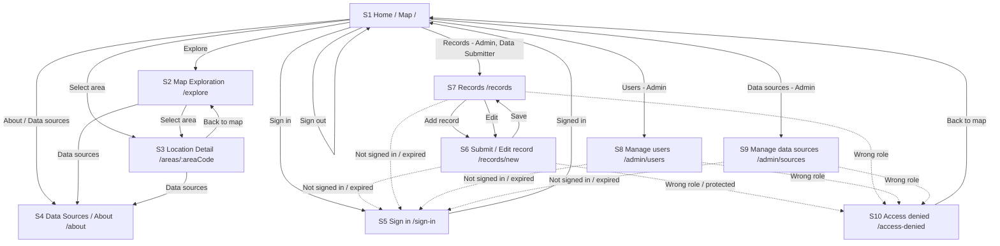

# IMPLEMENTATION_PLAN

# IMPLEMENTATION_PLAN.md: STRAINA

## 0. Plan details

| Field | Value |
|---|---|
| **App name** | STRAINA |
| **Built from PRD version** | v1.0 final draft candidate (11 Nov 2026, `docs/PRD.md`) |
| **Screen designs** | Stitch designs in `docs/designs/` (`00-style-guide.png`, `01-login.png`, `02-map.png`, `03-explore-time.png`, `04-resistance-patterns.png`, `05-potential-hotspots.jpeg`, `06-data-sources.png`, `07-public-explanation.png`, `08-submit-record.png`), `docs/designs/style-guide.md`, and `docs/designs/stitch-prompts.md` |
| **Plan version** | v1.0 |
| **Repository** | https://github.com/analystmodikwe/Straina |
| **Status** | Ready for team review |
| **Last updated** | 12 Nov 2026 |

---

## 1. Start here (instructions for the coding agent)

Before writing any code:

1. Read this whole file from top to bottom.
2. Read `docs/PRD.md`.
3. Look at the screen designs in `docs/designs/` and read `docs/designs/style-guide.md`.
4. Check Section 18. If any clarification is still Open, stop and ask the human. Do not start.
5. Check that the prerequisites in Section 4.2 are installed.
6. Start Phase 1 only. Follow Section 2 at all times.

---

## 2. Rules for the coding agent (copy word for word, do not edit)

1. **One phase at a time.** Only work on the phase the human asked for. When that phase's Definition of Done is complete, stop and wait for the human to say "Start Phase <N>".
2. **Test-driven development (TDD) for every task.** Follow the cycle in Section 12.1:
   - Write the test.
   - Run it and see it fail for the right reason.
   - Write the smallest code that makes it pass.
   - Run all tests.
   - Refactor while all tests still pass.
3. **Never cheat a test.** Never delete, skip, weaken or change a test just to make it pass. If you believe a test is wrong, stop and explain why to the human.
4. **Never break earlier work.** Every test from earlier phases must still pass before a phase is done.
5. **Build only what is planned.** Build only what is in this file and `docs/PRD.md`. Never build anything in Section 3.3 (Deferred).
6. **Ask, don't guess.** If anything is missing, unclear or contradictory, stop, add it to Section 18, and ask the human.
7. **Match the designs.** Every screen must match its design in Section 7.3: layout, order, labels, text, colours and spacing. Use the design tokens in Section 7.1. Never hard-code colours, font sizes or spacing.
8. **Every state, every screen.** Each screen must handle every state listed for it in Section 7.3 (chosen from normal, empty, loading, error, offline, success, plus any screen-specific states).
9. **Exact wording.** Use the exact labels and messages from the PRD. Never invent wording.
10. **Security first.**
    - Never put secret keys in app code, logs, test files or Git.
    - Every permission rule in Section 9 must be enforced on the server or database, never only in the app.
    - Every permission rule must have a test.
11. **Full check before "done".** Run the full check command (Section 4.3) before saying a phase is done, then add a short summary of the results to the Progress log (Section 17).
12. **Record your progress.** After each phase:
    - tick the checkboxes for that phase in this file;
    - add a row to the Progress log;
    - commit using the commit message given in the phase.
13. **No surprise libraries.** Do not add, remove or upgrade any library or tool not listed in Section 4.1 without asking the human first.
14. **Stuck rule.** If the same problem is still failing after 3 attempts, stop and report:
    - what you tried;
    - the exact error;
    - what you need from the human.
15. **Clean code.** Follow the folder structure in Section 5. Use the PRD's key terms (Section 3.4) for names in code. Keep files small and focused.

---

## 3. Project summary and scope

### 3.1 Summary

**Straina** is an intelligent antimicrobial-resistance (AMR) surveillance mapping platform that visualises where drug-resistant organisms are emerging, tracks how resistance patterns change over time, and identifies potential hotspots before they become larger public-health threats.

Straina transforms surveillance information into an interactive geographic and time-based experience. It is a surveillance and information tool, **not** a diagnostic or treatment system. The MVP displays clearly labelled synthetic demo data (BR13) loaded through database migrations, retaining full attribution and source transparency.

**Platform:** Web application (desktop and mobile browser responsive, 360px+). Deployed on Vercel with a Supabase PostgreSQL database, Supabase Auth, and Row-Level Security.

### 3.2 Features in scope

| ID | Feature | Priority | Built in phase |
|---|---|---|---|
| F1 | Interactive AMR Map (US1, US5, US13) | Must | Phase 4 |
| F2 | Time Exploration (US2) | Must | Phase 4 |
| F3 | Resistance Pattern Exploration (US3) | Must | Phase 5 |
| F4 | Potential Hotspot Identification (US4, BR12) | Must | Phase 5 |
| F5 | Data Source Context (US5) | Must | Phase 5 |
| F6 | Public Explanation Layer | Should | Phase 5 |
| F8 | Sign-in and Roles (US6, US7) | Must | Phase 3 |
| F9 | Record Submission and Management (US8, US9, US10) | Must | Phase 6 |
| F10 | User and Role Management (US11) | Must | Phase 7 |
| F11 | Data Source Management (US12) | Must | Phase 7 |

### 3.3 Deferred: do NOT build

- **F7 — Advanced Analysis:** Moved to Non-Goals in PRD Section 30.
- **NG1 — Live connection to external real surveillance APIs (WHO GLASS, NICD):** MVP uses clearly labelled synthetic demo data (BR1, BR13, OQ1).
- **NG2 — Medical diagnosis or individual treatment recommendations:** BR4 prohibits individual clinical advice.
- **NG3 — Patient-identifiable information:** Surveillance data holds aggregate counts only (`isolates_tested`, `isolates_resistant`).
- **NG4 — Declaring or confirming outbreaks:** Language is strictly restricted to "potential hotspot" (BR3). Never say "confirmed outbreak", "epidemic", "alert" or "danger".
- **NG5 — CSV bulk import of records:** Scheduled for post-MVP.
- **NG6 — Geospatial proximity / areas near a hotspot view:** Scheduled for post-MVP.
- **Dark mode:** PRD §18 and style guide specify light mode only for v1.
- **Self-registration / Sign-up form on S5:** Per PRD §8.4 and OQ11, Admin creates or invites accounts; visitor self-signup is deferred. S5 has email and password login only.
- **Password reset flow via email:** Deferred per OQ11.

### 3.4 Key terms (use these names in code)

| Term (PRD) | Name in code | Meaning |
|---|---|---|
| Admin | `admin`, `profiles.role = 'admin'` | Full permissions: manage users, data sources, and all observation records. |
| Data Submitter | `data_submitter`, `profiles.role = 'data_submitter'` | Can submit new observations; can edit/delete only records they created. |
| Analyst | `analyst`, `profiles.role = 'analyst'` | Read-only access to surveillance and observation data. |
| Visitor | Not authenticated (`anon`) | Unauthenticated user accessing public read-only views (S1–S4). |
| Data Source | `data_sources` table | Attributed source of AMR surveillance records (`is_demo = true` for MVP synthetic data). |
| Observation | `amr_observations` table | One AMR record: geographic coordinates, period, pathogen, antimicrobial, tested & resistant counts. |
| Potential Hotspot | `isPotentialHotspot()` | Area meeting BR12 threshold criteria. Never referred to as "outbreak". |
| Resistance % | Calculated in code | `(isolates_resistant / isolates_tested) * 100`. Never stored in DB; undefined if tested = 0. |

---

## 4. Tech stack, prerequisites and commands

### 4.1 Stack

| Layer | Tool | Version | Used for |
|---|---|---|---|
| Frontend | React + Vite | React 19, Vite 8 | UI components and development server |
| Routing | React Router DOM | React Router v7 | Client-side routing for S1–S10 routes |
| Language | TypeScript | TypeScript 6.0+ (strict mode) | Type safety across app, database types and tests |
| Styling | Tailwind CSS | Tailwind CSS 3.4 | Utility styling using design tokens from style guide |
| Icons | Lucide React | Latest stable | Minimal UI icons (20px, 1.5px stroke: zoom, close, offline) |
| Map | Leaflet + React Leaflet | Leaflet 1.9, React-Leaflet 5 | Interactive map rendering with OpenStreetMap tile layer |
| Backend & Database | Supabase (PostgreSQL, Auth, RLS) | Supabase CLI latest; `@supabase/supabase-js` v2 | Authentication, relational data storage, Row-Level Security |
| Validation | Zod | Zod v4 (present in repo) | Schema validation for forms and API responses |
| Unit & Component tests | Vitest + React Testing Library + jsdom | Vitest 5.1 | TDD tests for business rules, components, and views |
| Database & RLS tests | Vitest + `@supabase/supabase-js` | Latest | Integration tests validating Postgres RLS policies directly |
| Lint & Typecheck | ESLint + TypeScript Compiler (`tsc`) | ESLint 10, TypeScript 6 | Code quality and type enforcement |
| Hosting & Deployment | Vercel + Hosted Supabase | Latest | Continuous deployment on main merges; hosted Postgres |

### 4.2 Prerequisites on the computer

- [ ] Node.js 22 LTS or newer (`node -v`) and npm (`npm -v`)
- [ ] Git and a GitHub account (`analystmodikwe`)
- [ ] Supabase CLI (`npx supabase`)
- [ ] Google Chrome (for visual layout checks and dev testing)
- [ ] Accounts: Hosted Supabase project and Vercel project connected to the repository

### 4.3 Commands

| Purpose | Command |
|---|---|
| Install dependencies | `npm install` |
| Start the local dev server | `npm run dev` |
| Run linter | `npm run lint` |
| Run type checker | `npm run typecheck` |
| Run all unit and component tests | `npm test` |
| Run RLS integration tests | `npm run test:integration` |
| Full check (run before saying a phase is done) | `npm run lint && npm run typecheck && npm test && npm run build` |
| Build for production | `npm run build` |
| Start Supabase local dev stack | `npx supabase start` |
| Reset local database & apply migrations | `npx supabase db reset` |

---

## 5. Folder structure

```text
Straina/
├── .github/
│   ├── pull_request_template.md
│   └── workflows/
│       └── ci.yml
├── docs/
│   ├── PRD.md
│   ├── designs/
│   │   ├── README.md
│   │   ├── style-guide.md
│   │   ├── stitch-prompts.md
│   │   └── *.png, *.jpeg
│   └── team/
├── public/
│   ├── favicon.svg
│   └── icons.svg
├── src/
│   ├── api/
│   │   ├── auth.ts            # Supabase auth operations (OP1-OP3)
│   │   ├── observations.ts    # AMR observations querying and mutations (OP4, OP5, OP7-OP9)
│   │   ├── sources.ts         # Data sources management (OP6, OP12)
│   │   └── users.ts           # Admin user management (OP10, OP11)
│   ├── components/
│   │   ├── Header.tsx         # Shared header with wordmark, nav links, role badge & sign-in/out
│   │   ├── DemoNotice.tsx     # BR13 mandatory demo notice strip
│   │   ├── OfflineBanner.tsx  # ERR1 offline connectivity banner
│   │   ├── Toast.tsx          # Transient success toasts ("Record saved.", etc.)
│   │   ├── ErrorPanel.tsx     # ERR2-ERR14 error and empty state displays
│   │   ├── MapLegend.tsx      # Map marker explanation
│   │   ├── ProtectedRoute.tsx # Route guard for authentication and roles
│   │   └── UI/                # Base primitives (Button, TextField, SelectField, Modal)
│   ├── hooks/
│   │   ├── useAuth.ts         # Authentication context and role state
│   │   └── useOnline.ts       # Network online/offline status detection
│   ├── lib/
│   │   ├── hotspot.ts         # BR12 potential hotspot computation
│   │   ├── messages.ts        # Exact copy for all error, empty and notice states
│   │   └── supabase.ts        # Supabase client singleton
│   ├── pages/
│   │   ├── S1_HomeMap.tsx     # S1: Home / Map (route: /)
│   │   ├── S2_Explore.tsx     # S2: Map Exploration (route: /explore)
│   │   ├── S3_AreaDetail.tsx  # S3: Location Detail (route: /areas/:areaCode)
│   │   ├── S4_About.tsx       # S4: Data Sources & Explanation (route: /about)
│   │   ├── S5_SignIn.tsx      # S5: Sign In (route: /sign-in)
│   │   ├── S6_RecordForm.tsx  # S6: Submit/Edit Record (route: /records/new, /records/:id/edit)
│   │   ├── S7_RecordList.tsx  # S7: Records List (route: /records)
│   │   ├── S8_ManageUsers.tsx # S8: Manage Users (route: /admin/users)
│   │   ├── S9_ManageSources.tsx # S9: Manage Data Sources (route: /admin/sources)
│   │   └── S10_AccessDenied.tsx # S10: Access Denied (route: /access-denied)
│   ├── theme/
│   │   └── tokens.ts          # Design tokens matching style-guide.md
│   ├── types/
│   │   └── index.ts           # Database and application interfaces
│   ├── App.tsx                # App routing configuration
│   ├── main.tsx               # Entry point
│   └── index.css              # Global styles and Tailwind directives
├── supabase/
│   ├── config.toml
│   └── migrations/
│       ├── 20261111173438_init_schema.sql # Core tables & constraints
│       ├── 20261112000001_rls_policies.sql # Row-Level Security policies
│       └── 20261112000002_seed_demo_data.sql # Synthetic demo datasets & test accounts
├── tests/
│   ├── components/            # Component and screen state tests
│   ├── integration/           # Database and RLS tests against Supabase
│   └── unit/                  # Business logic unit tests (hotspot, validation)
├── IMPLEMENTATION_PLAN.md
├── package.json
├── tailwind.config.js
└── vite.config.ts
```

*Rule:* A new folder may only be created if it is added to this section first.

---

## 6. Environment variables and secrets

| Name | What it is | Where to get it | Public or secret | Used by |
|---|---|---|---|---|
| `VITE_SUPABASE_URL` | Hosted Supabase project URL | Supabase project dashboard -> Settings -> API | Public | React frontend app (`src/lib/supabase.ts`) |
| `VITE_SUPABASE_ANON_KEY` | Public anonymous publishable key | Supabase project dashboard -> Settings -> API | Public (safe with RLS) | React frontend app (`src/lib/supabase.ts`) |
| `SUPABASE_SERVICE_ROLE_KEY` | Admin / secret key | Supabase project dashboard -> Settings -> API | **Secret** | Database migration scripts and backend tasks only. **NEVER in `src/`**. |
| `SEED_TEST_PASSWORD` | Test accounts password | Team private channel | **Secret** | Seed migration script only |

### `.env.example` content

```bash
# Supabase configuration for Straina
VITE_SUPABASE_URL=https://your-project.supabase.co
VITE_SUPABASE_ANON_KEY=your-anon-key-here
```

### Environment rules

- Real secrets live in `.env` (local) and Vercel dashboard (production). `.env` is never committed.
- `.gitignore` explicitly includes `.env*` while preserving `!.env.example`.
- Frontend code in `src/` must **only** reference `VITE_` prefixed variables. A test (`T-SEC-1`) validates that `SERVICE_ROLE` never appears in `src/`.

---

## 7. Design system and screens

### 7.1 Design tokens (`src/theme/tokens.ts`)

Directly derived from `docs/designs/style-guide.md` and `docs/designs/stitch-prompts.md`:

| Token | Value | Use / Contrast |
|---|---|---|
| `color.primary` | `#0F4C5C` | Primary buttons, wordmark, standard area markers (9.5:1 with white) |
| `color.primaryHover` | `#0B3A47` | Primary button hover |
| `color.secondary` | `#334155` | Secondary text buttons, card headings |
| `color.accent` | `#0369A1` | Links, keyboard focus ring (5.9:1 on white) |
| `color.background` | `#F8FAFC` | Page background neutral |
| `color.surface` | `#FFFFFF` | Cards, panels, header surface |
| `color.text` | `#0F172A` | Main body and heading text (17:1 on background) |
| `color.textMuted` | `#475569` | Helper labels, placeholders, legend descriptions (7.6:1 on white) |
| `color.border` | `#CBD5E1` | Card dividers, decorative borders |
| `color.borderControl` | `#64748B` | Input fields, dropdown outlines (4.8:1 on white) |
| `color.error` | `#B42318` on `#FEF3F2` | ERR2–ERR14 error states and field validation borders |
| `color.offline` | `#7A2E0E` on `#FEF0C7` | ERR1 offline banner |
| `color.demo` | `#4C1D95` on `#EDE9FE` | BR13 mandatory demo notice strip and "Demo (synthetic)" tag |
| `color.success` | `#085D3A` on `#DCFAE6` | Toast notifications ("Record saved.", etc.) |
| `color.hotspot` | `#C2410C` | Potential hotspot marker fill (with white diagonal hatch) |
| `color.hotspotChip` | `#9A3412` on `#FFEDD5` | "Potential hotspot" status pill |
| `color.notHotspot` | `#2F7F9E` | "Not a potential hotspot" marker fill |
| `color.insufficientData`| `#475569` on `#E2E8F0` | Dashed outline marker and ERR5 status |
| `font.family` | Inter, system-ui, sans-serif | Typography across all screens |
| `spacing.base` | 4px scale (4, 8, 12, 16, 24, 32, 48) | Layout gutters and component padding |
| `radius.control` | 6px | Buttons, input fields, dropdowns |
| `radius.card` | 12px | Cards, panels, map legend container |
| `radius.tag` | 9999px (full pill) | Status tags and chips |
| `focus.ring` | 2px solid `#0369A1`, 2px offset | Keyboard focus visibility |

### 7.2 Shared components

| Component | File | States & Behavior |
|---|---|---|
| `Header` | `components/Header.tsx` | Height 64px (56px mobile), wordmark "Straina", links "Explore", "About / Data sources", role badge and "Sign in" / "Sign out". |
| `DemoNotice` | `components/DemoNotice.tsx` | Violet strip (`#4C1D95` on `#EDE9FE`): "Demo data — simulated (synthetic) for demonstration. Not real surveillance data." (BR13). |
| `OfflineBanner`| `components/OfflineBanner.tsx` | Amber banner (`#7A2E0E` on `#FEF0C7`): "You appear to be offline. Please check your connection and try again." (ERR1). |
| `Toast` | `components/Toast.tsx` | Auto-dismissing notification (`#085D3A` on `#DCFAE6`): "Record saved.", "Record deleted.", etc. |
| `MapLegend` | `components/MapLegend.tsx` | Floating card explaining marker states: Area with data, Potential hotspot, Not a potential hotspot, Insufficient data, No data. |
| `ErrorPanel` | `components/ErrorPanel.tsx` | Displays exact PRD copy with optional "Try again" action (ERR2, ERR3, ERR4, ERR5, ERR6). |

### 7.3 Screens

| ID | Screen Name | Route | Who can open it | Redirect if blocked | Required states | Phase |
|---|---|---|---|---|---|---|
| S1 | Home / Map | `/` | Everyone | — | Normal, Loading, Empty, Error, Offline | Phase 4 |
| S2 | Map Exploration | `/explore` | Everyone | — | Normal, Loading, Empty, Error, Offline | Phase 4 |
| S3 | Location Detail | `/areas/:areaCode` | Everyone | — | Normal, Loading, Empty, Error, Offline | Phase 5 |
| S4 | Data Sources & About | `/about` | Everyone | — | Normal, Loading, Empty, Error, Offline | Phase 5 |
| S5 | Sign in | `/sign-in` | Visitors only | Signed-in -> S1 | Normal, Loading, Error (ERR7, ERR8, ERR13), Offline | Phase 3 |
| S6 | Submit / Edit record | `/records/new`, `/records/:id/edit` | Admin; Data Submitter (own records only) | Visitor -> S5; Analyst -> S10 | Normal, Loading, Empty, Error (ERR12, ERR13, ERR14), Offline, Success | Phase 6 |
| S7 | Records list | `/records` | Admin; Data Submitter | Visitor -> S5; Analyst -> S10 | Normal, Loading, Empty, Error, Offline, Success | Phase 6 |
| S8 | Manage users & roles | `/admin/users` | Admin only | Visitor -> S5; Others -> S10 | Normal, Loading, Empty, Error, Offline, Success | Phase 7 |
| S9 | Manage data sources | `/admin/sources` | Admin only | Visitor -> S5; Others -> S10 | Normal, Loading, Empty, Error, Offline, Success | Phase 7 |
| S10| Access denied | `/access-denied` | Signed-in users | Visitor -> S5 | Normal (ERR9 with "Back to map" button) | Phase 3 |

---

## 8. Data model and database

### 8.1 Tables

#### Table: `data_sources`

```sql
create table data_sources (
  id                      uuid primary key default gen_random_uuid(),
  name                    text not null,
  url                     text,
  description             text,
  geographic_coverage     text not null,
  temporal_coverage_start date not null,
  temporal_coverage_end   date not null,
  last_updated            date not null,
  is_demo                 boolean not null default false,
  created_at              timestamptz not null default now()
);
```

#### Table: `profiles`

```sql
create table profiles (
  id         uuid primary key references auth.users(id) on delete cascade,
  email      text not null,
  role       text not null check (role in ('admin', 'data_submitter', 'analyst')),
  created_at timestamptz not null default now()
);
```

#### Table: `amr_observations`

```sql
create table amr_observations (
  id                 uuid primary key default gen_random_uuid(),
  data_source_id     uuid not null references data_sources(id) on delete restrict,
  area_code          text not null,
  area_name          text not null,
  area_level         text not null check (area_level in ('province', 'district', 'national')),
  latitude           numeric(9,6) not null,
  longitude          numeric(9,6) not null,
  period_start       date not null,
  period_end         date not null check (period_end >= period_start),
  pathogen           text not null,
  antimicrobial      text not null,
  isolates_tested    integer not null check (isolates_tested >= 0),
  isolates_resistant integer not null check (isolates_resistant >= 0 and isolates_resistant <= isolates_tested),
  created_by         uuid references profiles(id) on delete set null,
  created_at         timestamptz not null default now(),
  updated_at         timestamptz not null default now()
);
```

### 8.2 Relationships and delete behaviour

- `amr_observations.data_source_id -> data_sources.id`: Foreign key with `ON DELETE RESTRICT`. A data source cannot be deleted while observations reference it.
- `amr_observations.created_by -> profiles.id`: Foreign key with `ON DELETE SET NULL`. If a submitter account is removed, observations are preserved under admin custody.
- `profiles.id -> auth.users.id`: Foreign key with `ON DELETE CASCADE`.

### 8.3 Status and calculated fields

- **Resistance Percentage:** Calculated dynamically in queries or code as:
  $$\text{Resistance \%} = \frac{\sum \text{isolates\_resistant}}{\sum \text{isolates\_tested}} \times 100$$
  When $\text{isolates\_tested} = 0$, percentage is undefined and missing data is never represented as zero (BR5).
- **Potential Hotspot Rule (BR12):** An area is flagged as a potential hotspot for a pathogen-antimicrobial pair within the evaluation window if:
  1. $\text{Total records} \ge \text{HOTSPOT\_MIN\_OBSERVATIONS}$ (default baseline: 3 observations), AND
  2. $\text{Resistance \%} \ge \text{HOTSPOT\_THRESHOLD\_PCT}$ (default baseline: 25.0%).
  If records exist but count is below threshold, flag ERR5 ("There is not enough data to identify a potential hotspot here.").

### 8.4 Indexes

- `amr_observations(area_code, period_start, period_end)` — fast area inspection.
- `amr_observations(pathogen, antimicrobial)` — filter matching for map exploration.
- `amr_observations(created_by)` — submittor record lookups.
- `profiles(role)` — role checks.

### 8.5 Automatic jobs and triggers

- `handle_new_user()` trigger on `auth.users`: Automatically populates `profiles` row with default role `analyst` if not explicitly assigned.
- `update_amr_observations_timestamp()` trigger on `amr_observations`: Sets `updated_at = now()` before any row update.

### 8.6 Migrations (in order)

1. `20261111173438_init_schema.sql` — Tables, check constraints, foreign keys, and indexes.
2. `20261112000001_rls_policies.sql` — Row-Level Security enablement and role-based policies.
3. `20261112000002_seed_demo_data.sql` — Demo data source (`is_demo = true`), synthetic observations across South African provinces, and test accounts.

### 8.7 Seed data and test accounts

- **Data source row:** `name: "Straina demo dataset (synthetic)"`, `is_demo: true`, `geographic_coverage: "South Africa (Provinces)"`.
- **Synthetic records:** 12+ records covering Gauteng (GP), Western Cape (WC), KwaZulu-Natal (KZN), across 2025–2026 quarters, testing *Klebsiella pneumoniae* and *Staphylococcus aureus* with *Ciprofloxacin* and *Methicillin*.
- **Test accounts (passwords stored in SEED_TEST_PASSWORD only):**
  - Admin: `admin@straina.example.com`
  - Data Submitter: `submitter@straina.example.com`
  - Analyst: `analyst@straina.example.com`

---

## 9. Security and permissions

Row-Level Security (RLS) is enabled on all tables. Policies implement PRD §8.2:

| ID | Table | Action | Who is allowed | Rule / Policy Condition | Enforced by | Tests |
|---|---|---|---|---|---|---|
| SEC1 | `data_sources` | SELECT | Everyone (anon & authenticated) | `true` | RLS SELECT | T-PERM-1a |
| SEC2 | `data_sources` | INSERT / UPDATE / DELETE | Admin only | `auth.jwt() ->> 'role' in (select role from profiles where id = auth.uid() and role = 'admin')` | RLS WITH CHECK | T-PERM-5a, T-PERM-5b |
| SEC3 | `amr_observations` | SELECT | Everyone (anon & authenticated) | `true` | RLS SELECT | T-PERM-1a |
| SEC4 | `amr_observations` | INSERT | Admin, Data Submitter | `exists (select 1 from profiles where id = auth.uid() and role in ('admin', 'data_submitter'))` | RLS WITH CHECK | T-PERM-2a, T-PERM-2b |
| SEC5 | `amr_observations` | UPDATE | Admin (any) or Data Submitter (own only) | `exists (select 1 from profiles where id = auth.uid() and (role = 'admin' or (role = 'data_submitter' and created_by = auth.uid())))` | RLS USING & WITH CHECK | T-PERM-3a, T-PERM-3b |
| SEC6 | `amr_observations` | DELETE | Admin (any) or Data Submitter (own only) | Same as SEC5 | RLS USING | T-PERM-3a, T-PERM-3b |
| SEC7 | `profiles` | SELECT | Self or Admin | `auth.uid() = id or exists (select 1 from profiles where id = auth.uid() and role = 'admin')` | RLS USING | T-PERM-4a, T-PERM-4b |
| SEC8 | `profiles` | UPDATE | Admin only | `exists (select 1 from profiles where id = auth.uid() and role = 'admin')` | RLS WITH CHECK | T-PERM-4a, T-PERM-4b |
| SEC9 | `profiles` | INSERT / DELETE | Service role only | `false` | No public policy | T-SEC-2 |

### Always-on security checks

- `T-DB-RLS`: Automated script verifies RLS is active on every table in `public`.
- `T-NFR-SECRET`: Scan repository to verify `SUPABASE_SERVICE_ROLE_KEY` is not present in client bundle or Git.
- Inputs validated through Zod in the frontend and through SQL check constraints in the database.

---

## 10. Backend operations

All backend operations live in `src/api/`. Responses return typed data or exact PRD error strings from `src/lib/messages.ts`.

| ID | Operation | Who can call | Input | Output | Errors (exact PRD message) | Built as | Tests |
|---|---|---|---|---|---|---|---|
| OP1 | Sign in | Visitor | `email, password` | User session & profile | ERR7: "Email or password is incorrect." | `supabase.auth.signInWithPassword` | T-US6-1, T-US6-2 |
| OP2 | Sign out | Signed-in user | — | Session terminated | ERR4: "Something went wrong. Please try again." | `supabase.auth.signOut` | T-US7-1 |
| OP3 | Get session | Any | — | Session & user role | — | `supabase.auth.getSession` | T-US6-1 |
| OP4 | Get observations | Anyone | Filters (`period, pathogen, antimicrobial`) | Array of `amr_observations` | ERR3: "We couldn't load the latest data. Please try again." | Supabase query | T-US1-1, T-US2-2 |
| OP5 | Get area detail | Anyone | `areaCode` | Area records & source | ERR2: "No data are available for this selection." | Supabase query | T-US3-1, T-US3-4 |
| OP6 | Get data sources | Anyone | — | Array of `data_sources` | ERR3: "We couldn't load the latest data. Please try again." | Supabase query | T-US5-1 |
| OP7 | Submit record | Admin, Data Submitter | Record data fields | Inserted record | ERR12: "We couldn't save your changes. Please try again.", ERR14: "Resistant isolates can't be more than tested isolates." | Supabase insert | T-US8-1, T-US8-3 |
| OP8 | Edit record | Admin, or Submitter for own | `recordId, updates` | Updated record | ERR11: "You don't have permission to do this.", ERR12: "We couldn't save your changes." | Supabase update | T-US9-1, T-US9-2 |
| OP9 | Delete record | Admin, or Submitter for own | `recordId` | Success confirmation | ERR11: "You don't have permission to do this." | Supabase delete | T-US10-1, T-US10-2 |
| OP10| List users | Admin | — | Array of profiles | ERR11: "You don't have permission to do this." | Supabase query | T-US11-1 |
| OP11| Update user role | Admin | `userId, newRole` | Updated profile | ERR11: "You don't have permission to do this." | Supabase update | T-US11-1, T-US11-3 |
| OP12| Manage data source | Admin | Data source fields | Saved data source | ERR12: "We couldn't save your changes. Please try again." | Supabase upsert | T-US12-1, T-US12-3 |

---

## 11. Navigation rules

- **Public access:** S1, S2, S3, S4 are accessible to everyone without signing in.
- **Visitor accessing protected screen (S6, S7, S8, S9):** Redirect to `/sign-in` (S5) with ERR10 ("Please sign in to continue.").
- **Signed-in user with incorrect role:** Redirect to `/access-denied` (S10) with ERR9 ("You don't have permission to open this page.") and "Back to map" button.
- **Signed-in user opening `/sign-in`:** Redirect to `/` (S1).
- **Sign out:** Terminates session and redirects to `/` (S1). Pressing browser back must not reveal protected data.
- **Session expired:** Interceptor catches 401 token expiration and redirects to `/sign-in` with ERR8 ("Your session has expired. Please sign in again.").



---

## 12. Testing strategy

### 12.1 The TDD cycle (every task, every phase)

1. **Red:** Write one test for the requirement or acceptance criterion. Run it and verify it fails for the expected reason.
2. **Green:** Write the minimal code necessary to make the test pass.
3. **Refactor:** Clean up structure, remove duplication, verify TypeScript types, and rerun tests to ensure everything remains green.
4. Repeat for the next test.

### 12.2 Test levels

| Level | What it proves | Tool | Folder | Command |
|---|---|---|---|---|
| Unit | Business rules (BR12 hotspot logic, resistance %, date checks) | Vitest | `tests/unit/` | `npm test` |
| Component | Screen and UI component rendering across all states (normal, empty, loading, error, offline) | Vitest + React Testing Library | `tests/components/` | `npm test` |
| Database & RLS | PostgreSQL constraints and row-level security policies (allow & deny) | Vitest + `@supabase/supabase-js` | `tests/integration/` | `npm run test:integration` |
| Quality Checks | Linter, typecheck, production bundle build | ESLint, `tsc`, Vite | Root | `npm run check` |

### 12.3 Test IDs

| Prefix | Source | Example |
|---|---|---|
| `T-SETUP-#` | Setup and environment checks | `T-SETUP-1` |
| `T-US#-#` | User stories & acceptance criteria (PRD §5) | `T-US1-1`, `T-US8-3` |
| `T-PERM-#` | Role permissions and RLS policies (PRD §8.2) | `T-PERM-2a`, `T-PERM-2b` |
| `T-EC#-#` | Edge cases (PRD §31) | `T-EC1-1`, `T-EC9-1` |
| `T-QR-#` | Quality requirements (PRD §17) | `T-QR1`, `T-QR5` |
| `T-C-#` | Shared components | `T-C-1` |

### 12.4 Test data rules

- Tests never depend on execution order or side effects from other tests.
- RLS tests use test auth users (`admin`, `submitter`, `analyst`) and clean up created records.
- Synthetic demo data is used for component tests; no real patient data is ever permitted.

### 12.5 Coverage rules

- 100% of PRD acceptance criteria (`T-US#-#`) must have an automated test.
- 100% of permission rules (`T-PERM-#`) must have both allow and deny tests.
- 100% of edge cases (`T-EC#-#`) must have automated tests.

---

## 13. Phases

### 13.0 Phase overview

| Phase | Name | Features | Screens | Main Tests | Target |
|---|---|---|---|---|---|
| **Phase 1** | Foundation & Tokens | — | Shell, Header | `T-SETUP-1`, `T-C-1` to `T-C-4` | Day 1 |
| **Phase 2** | Database, RLS & Seed | — | — | `T-DB-1`, `T-PERM-1` to `T-PERM-5` | Day 1 |
| **Phase 3** | Authentication & Roles | F8 | S5, S10 | `T-US6-1`–`4`, `T-US7-1`–`2`, `T-EC5-1` | Day 2 |
| **Phase 4** | Map & Time View | F1, F2 | S1, S2 | `T-US1-1`–`5`, `T-US2-1`–`4`, `T-US13-1` | Day 2–3 |
| **Phase 5** | Patterns, Hotspots & About | F3, F4, F5, F6 | S3, S4 | `T-US3-1`–`4`, `T-US4-1`–`4`, `T-US5-1`–`4` | Day 3 |
| **Phase 6** | Record Submission & CRUD | F9 | S6, S7 | `T-US8-1`–`5`, `T-US9-1`–`4`, `T-US10-1`–`4` | Day 4 |
| **Phase 7** | Admin Management | F10, F11 | S8, S9 | `T-US11-1`–`3`, `T-US12-1`–`3` | Day 4 |
| **Phase 8** | Hardening & Quality | — | All | `T-EC1`–`10`, `T-QR1`–`13` | Day 5 |
| **Phase 9** | Deployment & Release | — | All | Production live verification | Checkpoint 3 / Final |

---

### Phase 1: Foundation & Tokens

**Goal:** Project dependencies, Tailwind configuration with design tokens, routing shell, header, and base shared components are operational and passing CI.

**Covers:** `package.json`, `tailwind.config.js`, `src/theme/tokens.ts`, `src/components/Header.tsx`, `src/components/DemoNotice.tsx`, `src/components/OfflineBanner.tsx`.

**Starts when:** Team approves implementation plan and Issue #17 is closed.

#### Step 1: Write the failing tests first (Red)

| Test ID | Level | File | What it checks |
|---|---|---|---|
| `T-SETUP-1` | Unit | `tests/unit/tokens.test.ts` | Design tokens in `tokens.ts` match `style-guide.md` (e.g., `color.primary` is `#0F4C5C`). |
| `T-C-1` | Component | `tests/components/Header.test.tsx` | Header renders wordmark "Straina", nav links, and visitor "Sign in" button. |
| `T-C-2` | Component | `tests/components/DemoNotice.test.tsx` | DemoNotice renders exact BR13 wording: "Demo data — simulated (synthetic) for demonstration. Not real surveillance data." |
| `T-C-3` | Component | `tests/components/OfflineBanner.test.tsx` | OfflineBanner displays ERR1 copy when offline; is hidden when online. |

- [x] All tests above are written, run, and fail for the expected reason.

#### Step 2: Backend (Green)
- Not applicable for Phase 1.

#### Step 3: Frontend (Green)
- [x] Install missing libraries: `react-router-dom`, `leaflet`, `react-leaflet`, `@supabase/supabase-js`, `lucide-react`, `tailwindcss`, `postcss`, `autoprefixer`.
- [x] Configure Tailwind CSS with the design tokens from `docs/designs/style-guide.md`.
- [x] Implement `src/theme/tokens.ts` and `src/lib/messages.ts` with exact PRD strings.
- [x] Build `Header.tsx`, `DemoNotice.tsx`, `OfflineBanner.tsx`, and `App.tsx` routing layout.

#### Step 4: Refactor and full check
- [x] Code formatted and clean; no unused imports.
- [x] Full check passes: `npm run lint && npm run typecheck && npm test && npm run build`.

#### Step 5: Manual checks (human)
- [x] Running `npm run dev` opens the app shell with Header and design token colors rendered.

#### Definition of Done
- [x] Every test in Step 1 passes.
- [x] Full check command passes without warnings or errors.
- [x] Progress log updated in Section 17.

**Commit message:** `feat(foundation): setup router, tailwind tokens and shared layout (#20)`  
**STOP. Wait for the human to say "Start Phase 2".**

---

### Phase 2: Database, RLS & Seed Data

**Goal:** Supabase database schema, constraints, Row-Level Security policies, and labelled synthetic demo records are created and tested.

**Covers:** `supabase/migrations/` (tables, RLS policies, seed data).

**Starts when:** Phase 1 is complete and human says "Start Phase 2".

#### Step 1: Write the failing tests first (Red)

| Test ID | Level | File | What it checks |
|---|---|---|---|
| `T-DB-1` | Integration | `tests/integration/schema.test.ts` | Tables `data_sources`, `profiles`, `amr_observations` exist with required constraints. |
| `T-PERM-1a`| Integration | `tests/integration/rls.test.ts` | Anon visitors can read `data_sources` and `amr_observations`. |
| `T-PERM-2b`| Integration | `tests/integration/rls.test.ts` | Anon visitors and Analysts are denied INSERT into `amr_observations`. |
| `T-PERM-3b`| Integration | `tests/integration/rls.test.ts` | Data Submitters cannot UPDATE or DELETE records created by others. |
| `T-PERM-4b`| Integration | `tests/integration/rls.test.ts` | Non-admins are denied SELECT and UPDATE on `profiles` role column. |
| `T-PERM-5b`| Integration | `tests/integration/rls.test.ts` | Non-admins are denied INSERT/UPDATE/DELETE on `data_sources`. |
| `T-DB-SEED` | Integration | `tests/integration/seed.test.ts` | Seed dataset contains demo source with `is_demo = true` and synthetic observation records. |

- [ ] All tests above are written, run, and fail for the expected reason.

#### Step 2: Backend (Green)
- [ ] Create `supabase/migrations/20261111173438_init_schema.sql` with tables and check constraints.
- [ ] Create `supabase/migrations/20261112000001_rls_policies.sql` with full RLS policy rules (SEC1–SEC9).
- [ ] Create `supabase/migrations/20261112000002_seed_demo_data.sql` with synthetic records and test accounts.
- [ ] Run `npx supabase db reset` to apply migrations locally.

#### Step 3: Frontend (Green)
- [ ] Setup `src/lib/supabase.ts` singleton reading public environment variables.
- [ ] Export TypeScript database types in `src/types/index.ts`.

#### Step 4: Refactor and full check
- [ ] Migration scripts adhere to PostgreSQL strict standards; all RLS tests pass.
- [ ] Full check passes.

#### Step 5: Manual checks (human)
- [ ] Inspect local Supabase Studio: verify 3 tables have RLS enabled and demo data rows appear.

#### Definition of Done
- [ ] Every test in Step 1 passes.
- [ ] Database reset succeeds with clean seed data.
- [ ] Progress log updated in Section 17.

**Commit message:** `feat(db): implement schema, rls policies and seed demo data (#26)`  
**STOP. Wait for the human to say "Start Phase 3".**

---

### Phase 3: Authentication and Roles

**Goal:** Supabase authentication flow, S5 Sign in, header role display, sign-out, session expiration handling, and protected route redirection are working.

**Covers:** `src/pages/S5_SignIn.tsx`, `src/pages/S10_AccessDenied.tsx`, `src/components/ProtectedRoute.tsx`, `src/hooks/useAuth.ts`, `src/api/auth.ts`.

**Starts when:** Phase 2 is complete and human says "Start Phase 3".

#### Step 1: Write the failing tests first (Red)

| Test ID | Level | File | What it checks |
|---|---|---|---|
| `T-US6-1` | Component | `tests/components/SignIn.test.tsx` | Valid credentials signs in user and redirects to `/`. |
| `T-US6-2` | Component | `tests/components/SignIn.test.tsx` | Invalid credentials displays ERR7: "Email or password is incorrect." |
| `T-US6-3` | Component | `tests/components/SignIn.test.tsx` | Empty field triggers ERR13: "This field is required." without request. |
| `T-US7-1` | Component | `tests/components/Header.test.tsx` | "Sign out" button terminates session and returns user to S1 as visitor. |
| `T-US7-2` | Component | `tests/components/ProtectedRoute.test.tsx` | Browser back navigation after sign-out redirects to S5; protected data hidden. |
| `T-EC5-1` | Component | `tests/components/ProtectedRoute.test.tsx` | Expired session redirects to S5 with ERR8: "Your session has expired. Please sign in again." |
| `T-EC3-1` | Component | `tests/components/AccessDenied.test.tsx` | Wrong role opening protected route shows S10 with ERR9 and "Back to map". |

- [ ] All tests above are written, run, and fail for the expected reason.

#### Step 2: Backend (Green)
- [ ] Configure `handle_new_user()` trigger to automatically create profile on sign-up if needed.

#### Step 3: Frontend (Green)
- [ ] Implement `src/hooks/useAuth.ts` and `src/api/auth.ts` (OP1–OP3).
- [ ] Build `S5_SignIn.tsx` matching `docs/designs/01-login.png` with all specified error states.
- [ ] Build `S10_AccessDenied.tsx` with ERR9 and "Back to map" button.
- [ ] Implement `ProtectedRoute.tsx` enforcing public vs role-protected views.
- [ ] Update `Header.tsx` to display role badge and "Sign out" when authenticated.

#### Step 4: Refactor and full check
- [ ] Clean code; full check passes.

#### Step 5: Manual checks (human)
- [ ] Log in as Admin, Data Submitter, and Analyst test accounts; verify header updates with correct role name.
- [ ] Log out; verify header switches back to "Sign in".

#### Definition of Done
- [ ] Every test in Step 1 passes.
- [ ] Full check passes.
- [ ] Progress log updated in Section 17.

**Commit message:** `feat(auth): add sign-in, session management and route guards (#28)`  
**STOP. Wait for the human to say "Start Phase 4".**

---

### Phase 4: Map & Time Exploration

**Goal:** S1 Home Map and S2 Map Exploration provide an interactive Leaflet map with OpenStreetMap tiles, time period filtering, legend, and mandatory demo data notices.

**Covers:** `src/pages/S1_HomeMap.tsx`, `src/pages/S2_Explore.tsx`, `src/components/MapLegend.tsx`, Leaflet integration.

**Starts when:** Phase 3 is complete and human says "Start Phase 4".

#### Step 1: Write the failing tests first (Red)

| Test ID | Level | File | What it checks |
|---|---|---|---|
| `T-US1-1` | Component | `tests/components/MapView.test.tsx` | Map container and OpenStreetMap tiles render. |
| `T-US1-2` | Component | `tests/components/MapView.test.tsx` | Surveillance observations are plotted as markers at correct lat/long. |
| `T-US1-3` | Component | `tests/components/MapLegend.test.tsx` | Legend displays markers for all states (with data, potential hotspot, insufficient, no data). |
| `T-US1-4` | Component | `tests/components/MapView.test.tsx` | Network or data failure displays ERR3: "We couldn't load the latest data. Please try again." with "Try again". |
| `T-US1-5` | Component | `tests/components/MapView.test.tsx` | When demo source data is displayed, the BR13 demo notice is visible. |
| `T-US2-1` | Component | `tests/components/ExploreTime.test.tsx` | User can select time periods from the dropdown. |
| `T-US2-2` | Component | `tests/components/ExploreTime.test.tsx` | Displayed markers update dynamically according to the selected time window. |
| `T-US2-3` | Component | `tests/components/ExploreTime.test.tsx` | Empty period selection displays ERR2: "No data are available for this selection." |
| `T-US2-4` | Component | `tests/components/ExploreTime.test.tsx` | Missing data for a region is never drawn as zero (BR5). |

- [ ] All tests above are written, run, and fail for the expected reason.

#### Step 2: Backend (Green)
- [ ] Implement query in `src/api/observations.ts` fetching observation records filtered by period and coordinates.

#### Step 3: Frontend (Green)
- [ ] Build `MapLegend.tsx` with marker tokens from `style-guide.md`.
- [ ] Implement `S1_HomeMap.tsx` matching `docs/designs/02-map.png` with Leaflet.
- [ ] Implement `S2_Explore.tsx` matching `docs/designs/03-explore-time.png` with period selector.
- [ ] Wire demo notice banner (BR13) whenever records originate from demo data sources.

#### Step 4: Refactor and full check
- [ ] Verify clean component decomposition and type-checked props.
- [ ] Full check passes.

#### Step 5: Manual checks (human)
- [ ] Open `/` and `/explore` in desktop and mobile viewports (390px); interact with zoom and period dropdowns.

#### Definition of Done
- [ ] Every test in Step 1 passes.
- [ ] Full check passes.
- [ ] Progress log updated in Section 17.

**Commit message:** `feat(map): implement interactive map, time exploration and legend (#32)`  
**STOP. Wait for the human to say "Start Phase 5".**

---

### Phase 5: Resistance Patterns, Potential Hotspots & About

**Goal:** S3 Location Detail, BR12 Potential Hotspot calculation, S4 Data Sources / About, and F6 Public Explanation Layer are fully functional.

**Covers:** `src/pages/S3_AreaDetail.tsx`, `src/pages/S4_About.tsx`, `src/lib/hotspot.ts`.

**Starts when:** Phase 4 is complete and human says "Start Phase 5".

#### Step 1: Write the failing tests first (Red)

| Test ID | Level | File | What it checks |
|---|---|---|---|
| `T-US3-1` | Component | `tests/components/AreaDetail.test.tsx` | Selecting an area displays area name, coverage, and AMR patterns. |
| `T-US3-3` | Component | `tests/components/AreaDetail.test.tsx` | Attribution and link to data source are displayed. |
| `T-US4-1` | Unit | `tests/unit/hotspot.test.ts` | Hotspot function flags potential hotspot only when observations >= min and resistance >= threshold (BR12). |
| `T-US4-2` | Component | `tests/components/MapView.test.tsx` | Hotspot layer toggles hatched orange markers with label "Potential hotspot" (BR3, BR12). |
| `T-US4-3` | Component | `tests/components/AreaDetail.test.tsx` | Area with insufficient records shows ERR5: "There is not enough data to identify a potential hotspot here." |
| `T-US4-4` | Component | `tests/components/AreaDetail.test.tsx` | Wording is strictly "potential hotspot"; never says "confirmed outbreak" (BR3). |
| `T-US5-1` | Component | `tests/components/About.test.tsx` | S4 lists data sources with coverage, update dates, and "Demo (synthetic)" tag. |
| `T-US5-4` | Component | `tests/components/About.test.tsx` | Record without linked source is not displayed as surveillance data. |

- [ ] All tests above are written, run, and fail for the expected reason.

#### Step 2: Backend (Green)
- [ ] Implement `src/api/sources.ts` to retrieve data source records with coverage metadata.

#### Step 3: Frontend (Green)
- [ ] Build pure function `src/lib/hotspot.ts` implementing BR12 logic.
- [ ] Build `S3_AreaDetail.tsx` matching `docs/designs/04-resistance-patterns.png`.
- [ ] Add hotspot toggle layer on S2 matching `docs/designs/05-potential-hotspots.jpeg`.
- [ ] Build `S4_About.tsx` matching `docs/designs/06-data-sources.png` and `docs/designs/07-public-explanation.png`.

#### Step 4: Refactor and full check
- [ ] Clean code; ensure no medical advice is rendered; full check passes.

#### Step 5: Manual checks (human)
- [ ] Verify S4 about text accurately explains that Straina is a surveillance tool, not a diagnostic system.

#### Definition of Done
- [ ] Every test in Step 1 passes.
- [ ] Checkpoint 3 demo requirements satisfied.
- [ ] Progress log updated in Section 17.

**Commit message:** `feat(surveillance): add hotspot detection, area inspection and about view (#34)`  
**STOP. Wait for the human to say "Start Phase 6".**

---

### Phase 6: Record Submission and Management

**Goal:** Authenticated Admins and Data Submitters can add, edit, and delete resistance observation records with validation (S6, S7).

**Covers:** `src/pages/S6_RecordForm.tsx`, `src/pages/S7_RecordList.tsx`, `src/api/observations.ts`.

**Starts when:** Phase 5 is complete and human says "Start Phase 6".

#### Step 1: Write the failing tests first (Red)

| Test ID | Level | File | What it checks |
|---|---|---|---|
| `T-US8-1` | Component | `tests/components/RecordForm.test.tsx` | Data Submitter submits valid record -> saves with `created_by = auth.uid()` -> toast "Record saved." -> navigates to S7. |
| `T-US8-2` | Component | `tests/components/RecordForm.test.tsx` | Empty required field prevents save and displays ERR13: "This field is required." |
| `T-US8-3` | Component | `tests/components/RecordForm.test.tsx` | `isolates_resistant > isolates_tested` displays ERR14: "Resistant isolates can't be more than tested isolates." |
| `T-US8-4` | Component | `tests/components/RecordForm.test.tsx` | Analyst or visitor opening `/records/new` cannot see form (visitor -> S5, Analyst -> S10). |
| `T-US9-1` | Component | `tests/components/RecordForm.test.tsx` | Data Submitter can edit own record; saves changes successfully. |
| `T-US9-2` | Component | `tests/components/RecordForm.test.tsx` | Data Submitter attempting to edit another's record is blocked with ERR11. |
| `T-US9-3` | Component | `tests/components/RecordForm.test.tsx` | Admin can edit any record. |
| `T-US10-1`| Component | `tests/components/RecordList.test.tsx` | Submitter deletes own record after confirmation; record removed from list. |
| `T-US10-4`| Component | `tests/components/RecordList.test.tsx` | Canceling delete confirmation preserves the record. |

- [ ] All tests above are written, run, and fail for the expected reason.

#### Step 2: Backend (Green)
- [ ] Add `createObservation`, `updateObservation`, `deleteObservation` in `src/api/observations.ts` using Supabase RLS.

#### Step 3: Frontend (Green)
- [ ] Build `S6_RecordForm.tsx` matching `docs/designs/08-submit-record.png` with Zod validation.
- [ ] Build `S7_RecordList.tsx` showing observations list, "Add record" button, and conditional Edit/Delete actions.
- [ ] Implement delete confirmation modal before triggering deletion.

#### Step 4: Refactor and full check
- [ ] Clean code; verify all RLS and frontend checks pass.

#### Step 5: Manual checks (human)
- [ ] Log in as Submitter: add record, edit it, delete it. Verify an Analyst cannot access `/records`.

#### Definition of Done
- [ ] Every test in Step 1 passes.
- [ ] Full check passes.
- [ ] Progress log updated in Section 17.

**Commit message:** `feat(records): add observation submission, editing and deletion (#42)`  
**STOP. Wait for the human to say "Start Phase 7".**

---

### Phase 7: Admin Management (Users & Data Sources)

**Goal:** Admins can view users and update their roles (S8), as well as create and edit data sources (S9).

**Covers:** `src/pages/S8_ManageUsers.tsx`, `src/pages/S9_ManageSources.tsx`, `src/api/users.ts`.

**Starts when:** Phase 6 is complete and human says "Start Phase 7".

#### Step 1: Write the failing tests first (Red)

| Test ID | Level | File | What it checks |
|---|---|---|---|
| `T-US11-1`| Component | `tests/components/ManageUsers.test.tsx` | Admin can change user role (`admin`, `data_submitter`, `analyst`) -> toast "Role updated." |
| `T-US11-2`| Component | `tests/components/ManageUsers.test.tsx` | Non-admin opening `/admin/users` is redirected (visitor -> S5, others -> S10). |
| `T-US12-1`| Component | `tests/components/ManageSources.test.tsx`| Admin can add a new data source -> appears in S9 list and in S6 source dropdown. |
| `T-US12-2`| Component | `tests/components/ManageSources.test.tsx`| Non-admin opening `/admin/sources` is redirected to S10. |
| `T-EC10-1`| Component | `tests/components/ManageUsers.test.tsx` | Admin attempting to demote the sole remaining Admin is blocked. |

- [ ] All tests above are written, run, and fail for the expected reason.

#### Step 2: Backend (Green)
- [ ] Implement `src/api/users.ts` with `getUsers()` and `updateRole()`.
- [ ] Implement data source creation and update functions in `src/api/sources.ts`.

#### Step 3: Frontend (Green)
- [ ] Build `S8_ManageUsers.tsx` with user list and role selector.
- [ ] Build `S9_ManageSources.tsx` with data source creation form and `is_demo` toggle.

#### Step 4: Refactor and full check
- [ ] Clean code; full check passes.

#### Step 5: Manual checks (human)
- [ ] Log in as Admin: change an Analyst to Data Submitter; verify permissions update on reload.

#### Definition of Done
- [ ] Every test in Step 1 passes.
- [ ] Full check passes.
- [ ] Progress log updated in Section 17.

**Commit message:** `feat(admin): implement user roles and data source management (#47)`  
**STOP. Wait for the human to say "Start Phase 8".**

---

### Phase 8: Hardening, Accessibility & Edge Cases

**Goal:** All edge cases (EC1–EC10) and quality requirements (QR1–QR13) pass. Offline detection, keyboard accessibility, contrast checks, and error boundaries are verified.

**Covers:** Error boundaries, offline listener, accessibility attributes, bundle size audit.

**Starts when:** Phase 7 is complete and human says "Start Phase 8".

#### Step 1: Write the failing tests first (Red)

| Test ID | Level | File | What it checks |
|---|---|---|---|
| `T-EC1-1` | Component | `tests/components/Offline.test.tsx` | Offline state shows ERR1, disables Save/Add/Edit/Delete/Sign in, and retains form data. |
| `T-EC2-1` | Component | `tests/components/EmptyState.test.tsx` | No data displays ERR2 and the area is never drawn as zero (BR5). |
| `T-EC3-1` | Component | `tests/components/ProtectedRoute.test.tsx` | Wrong role redirects to S10, displays ERR9, and hides protected form data. |
| `T-EC4-1` | Unit | `tests/unit/hotspot.test.ts` | Insufficient observations do not flag a hotspot and display ERR5. |
| `T-EC5-1` | Component | `tests/components/ProtectedRoute.test.tsx` | Expired session redirects to S5 and displays ERR8. |
| `T-EC6-1` | Component | `tests/components/ProtectedRoute.test.tsx` | Visitor accessing protected URL redirects to S5 with ERR10; role is checked after sign-in. |
| `T-EC7-1` | Integration | `tests/integration/rls.test.ts` | Database rejects a Data Submitter's update or delete of another person's record; ERR11 is shown. |
| `T-EC8-1` | Component | `tests/components/ErrorPanel.test.tsx` | Server loading failure displays ERR3 with "Try again". |
| `T-EC9-1` | Unit | `tests/unit/validation.test.ts` | Resistant count greater than tested count or missing required fields fails validation. |
| `T-EC10-1` | Component | `tests/components/ManageUsers.test.tsx` | Last Admin cannot remove their own Admin role. |
| `T-QR1` | Manual | — | Check desktop and phone widths in each supported browser. |
| `T-QR2` | Component | `tests/components/LoadingState.test.tsx` | Every data-loading screen (S1–S4, S6–S9) displays a loading state. |
| `T-QR3` | Component | `tests/components/EmptyState.test.tsx` | Every data-loading screen displays the correct empty state when no data exists. |
| `T-QR4` | Component | `tests/components/ErrorPanel.test.tsx` | Every data-loading screen displays ERR3 when loading fails. |
| `T-QR5` | Component | `tests/components/Offline.test.tsx` | Screens requiring the server display ERR1 when offline. |
| `T-QR6` | Component | `tests/components/MapView.test.tsx` | Missing data is never drawn as zero on S1–S3. |
| `T-QR7` | Component | `tests/components/AreaDetail.test.tsx`, `tests/components/About.test.tsx` | Every displayed record shows its data source on S3 and S4. |
| `T-QR8` | Component | `tests/components/DemoNotice.test.tsx` | Demo data always displays the BR13 notice; verify T-US13-1 to T-US13-3. |
| `T-QR9` | Integration | `tests/integration/queries.test.ts` | Network requests retrieve only the data needed when the time period changes. |
| `T-QR10` | Manual | — | Smoke test Flows 1–4 in the latest Chrome, Edge, Firefox and Safari. |
| `T-QR11` | Integration | `tests/integration/rls.test.ts` | Every permission in Section 8.2 is enforced by the database; verify T-PERM-1a, T-PERM-2a/b, T-PERM-3a/b, T-PERM-4a/b, T-PERM-5a/b and T-SEC-2. |
| `T-QR12` | Unit | `tests/unit/security.test.ts` | No secrets exist in the repository or client bundle; service-role key is absent from client code. |
| `T-QR13` | Component | `tests/components/A11y.test.tsx` | Accessibility meets the proposed WCAG 2.1 AA target, including contrast and keyboard focus. |
| `T-SEC-1` | Unit | `tests/unit/security.test.ts` | Secret scan confirms `SUPABASE_SERVICE_ROLE_KEY` does not exist under `src/`. |

- [ ] All tests above are written, run, and fail for the expected reason.

#### Step 2: Backend (Green)
- [ ] Ensure all database constraints reject malformed counts or dates.

#### Step 3: Frontend (Green)
- [ ] Implement global offline listener using `useOnline` hook.
- [ ] Add ARIA labels and keyboard focus indicators across all buttons and inputs.
- [ ] Audit bundle size: verify initial compressed JS is within fast-loading limits.

#### Step 4: Refactor and full check
- [ ] Full check passes cleanly.

#### Step 5: Manual checks (human)
- [ ] Switch browser to offline mode in DevTools: verify ERR1 appears and save buttons disable.
- [ ] Keyboard navigation test: tab through the entire app using keyboard only.

#### Definition of Done
- [ ] Every test in Step 1 passes.
- [ ] Full check passes.
- [ ] Progress log updated in Section 17.

**Commit message:** `chore(hardening): edge cases, accessibility and security audit (#55)`  
**STOP. Wait for the human to say "Start Phase 9".**

---

### Phase 9: Deployment and Release

**Goal:** The application is live on Vercel, connected to hosted Supabase, and verified against all user flows in an incognito browser window.

**Covers:** Vercel deployment, hosted Supabase migrations push, README update, demo rehearsal.

**Starts when:** Phase 8 is complete and human says "Start Phase 9".

#### Step 1: Write the failing tests first (Red)

| Test ID | Level | File | What it checks |
|---|---|---|---|
| `T-REL-1` | Integration | `tests/integration/release.test.ts` | Production environment variables `VITE_SUPABASE_URL` and `VITE_SUPABASE_ANON_KEY` are configured. |
| `T-REL-2` | Integration | `tests/integration/release.test.ts` | Hosted Supabase instance contains all migrations up to date. |

- [ ] Tests written and fail before deployment verification.

#### Step 2: Backend (Green)
- [ ] Run `npx supabase db push` to apply all migrations and demo seed to hosted Supabase project.

#### Step 3: Frontend (Green)
- [ ] Connect GitHub repository to Vercel (Thami).
- [ ] Configure `VITE_SUPABASE_URL` and `VITE_SUPABASE_ANON_KEY` in Vercel project settings.
- [ ] Deploy main branch; verify build succeeds.
- [ ] Update `README.md` with: Live link, Stitch link, Loom link, test login accounts, and architecture.

#### Step 4: Refactor and full check
- [ ] Clone fresh repository, run `npm install && npm test && npm run build` -> all green.

#### Step 5: Manual checks (human)
- [ ] Open live Vercel URL in private/incognito window.
- [ ] Walk through demo script:
  1. Open map -> view national AMR surveillance.
  2. Filter by time window and pathogen.
  3. Toggle potential hotspot layer -> inspect flagged area.
  4. View data source attribution and demo label.
  5. Log in as Submitter -> submit a record.
  6. Verify record updates on the map.
  7. Log out.

#### Definition of Done
- [ ] Live URL is responsive and functional.
- [ ] README covers all items from Mentor Brief Step 7.
- [ ] All phases complete; checkboxes ticked.

**Commit message:** `chore(release): complete v1.0 release and documentation (#57)`  
**STOP. The build is complete.**

---

## 14. Traceability matrix

| Feature | Stories | Acceptance Tests | Rule Tests | Screens | Operations | Phase |
|---|---|---|---|---|---|---|
| **F1 Interactive Map** | US1, US13 | `T-US1-1` to `T-US1-5`, `T-US13-1` | `BR1`, `BR2`, `BR13` | S1 | OP4 | Phase 4 |
| **F2 Time Exploration** | US2 | `T-US2-1` to `T-US2-4` | `BR5` | S2 | OP4 | Phase 4 |
| **F3 Resistance Patterns** | US3 | `T-US3-1` to `T-US3-4` | `BR2`, `BR5` | S3 | OP5 | Phase 5 |
| **F4 Potential Hotspots** | US4 | `T-US4-1` to `T-US4-4` | `BR3`, `BR12` | S2, S3 | OP4, OP5 | Phase 5 |
| **F5 Data Sources** | US5, US13 | `T-US5-1` to `T-US5-4`, `T-US13-2` | `BR1`, `BR2`, `BR13` | S4 | OP6 | Phase 5 |
| **F6 Public Explanation** | US1, US5 | `T-US1-3`, `T-US5-3` | `BR4` | S4 | OP6 | Phase 5 |
| **F8 Sign-in & Roles** | US6, US7 | `T-US6-1` to `T-US6-4`, `T-US7-1` to `T-US7-2` | `BR6`, `SEC1`–`SEC9` | S5, S10 | OP1, OP2, OP3 | Phase 3 |
| **F9 Record Management** | US8, US9, US10 | `T-US8-1` to `T-US8-5`, `T-US9-1` to `T-US9-4`, `T-US10-1` to `T-US10-4` | `BR7`, `BR8`, `BR9`, `SEC4`–`SEC6` | S6, S7 | OP7, OP8, OP9 | Phase 6 |
| **F10 User Management** | US11 | `T-US11-1` to `T-US11-3` | `BR10`, `SEC7`, `SEC8` | S8 | OP10, OP11 | Phase 7 |
| **F11 Source Management**| US12 | `T-US12-1` to `T-US12-3` | `BR11`, `SEC2` | S9 | OP12 | Phase 7 |
| **Cross-cutting** | — | `T-EC1` to `T-EC10`, `T-QR1` to `T-QR13` | `BR1`–`BR13`, `SEC1`–`SEC9` | All | All | Phase 1, 2, 8, 9 |

---

## 15. Acceptance test checklist

- [ ] `T-US1-1`: Map is visible on S1
- [ ] `T-US1-2`: Geographic AMR information is represented
- [ ] `T-US1-3`: Map legend is available and explains all marker states
- [ ] `T-US1-4`: Server error displays ERR3 with "Try again" button
- [ ] `T-US1-5`: Demo data is displayed with mandatory BR13 notice
- [ ] `T-US2-1`: User can select a time period
- [ ] `T-US2-2`: Displayed data updates according to the selected period
- [ ] `T-US2-3`: No-data period displays ERR2
- [ ] `T-US2-4`: Missing data is never treated as zero (BR5)
- [ ] `T-US3-1`: User can select a geographic area
- [ ] `T-US3-2`: Area resistance information is displayed
- [ ] `T-US3-3`: Data source and attribution are displayed
- [ ] `T-US3-4`: Area with no data displays ERR2
- [ ] `T-US4-1`: Hotspot calculation defined in `lib/hotspot.ts` before layer build
- [ ] `T-US4-2`: Areas meeting BR12 rule are highlighted with diagonal hatch
- [ ] `T-US4-3`: Areas with insufficient data show ERR5 and are not flagged
- [ ] `T-US4-4`: Status is strictly "potential hotspot"; never "outbreak"
- [ ] `T-US5-1`: Data source is identifiable on S4 and S3
- [ ] `T-US5-2`: Coverage dates and update timestamps are available
- [ ] `T-US5-3`: Geographic and temporal scope are clearly displayed
- [ ] `T-US5-4`: Observations without source cannot be displayed
- [ ] `T-US6-1`: Valid credentials sign in user and navigate to requested page
- [ ] `T-US6-2`: Invalid credentials display ERR7 on S5
- [ ] `T-US6-3`: Empty fields display ERR13 without sending request
- [ ] `T-US6-4`: Expired session redirects to S5 with ERR8
- [ ] `T-US7-1`: Sign out ends session and navigates to S1
- [ ] `T-US7-2`: Back button after sign out redirects to S5; data protected
- [ ] `T-US8-1`: Submitter completes S6 form; saves record with `created_by`
- [ ] `T-US8-2`: Required field empty blocks save with ERR13
- [ ] `T-US8-3`: `isolates_resistant > isolates_tested` blocks save with ERR14
- [ ] `T-US8-4`: Analyst/visitor opening `/records/new` is redirected
- [ ] `T-US8-5`: Direct database insert from Analyst is rejected by RLS
- [ ] `T-US9-1`: Submitter edits own record; change is saved
- [ ] `T-US9-2`: Submitter editing another's record is refused with ERR11
- [ ] `T-US9-3`: Admin can edit any record
- [ ] `T-US9-4`: Analyst editing record directly is rejected by RLS
- [ ] `T-US10-1`: Submitter deletes own record after confirmation
- [ ] `T-US10-2`: Submitter deleting another's record is refused with ERR11
- [ ] `T-US10-3`: Admin can delete any record
- [ ] `T-US10-4`: Canceling delete modal preserves record
- [ ] `T-US11-1`: Admin updates user role; change takes effect on next load
- [ ] `T-US11-2`: Non-admin opening `/admin/users` is redirected
- [ ] `T-US11-3`: Direct role update from non-admin rejected by RLS
- [ ] `T-US12-1`: Admin adds data source; appears in S9 and S6 dropdown
- [ ] `T-US12-2`: Non-admin opening `/admin/sources` is redirected
- [ ] `T-US12-3`: Direct data source insert from non-admin rejected by RLS
- [ ] `T-US13-1`: Screens displaying demo data show BR13 notice
- [ ] `T-US13-2`: Demo data source is labelled "Demo (synthetic)"
- [ ] `T-US13-3`: Demo data is never described as real surveillance data
- [ ] `T-PERM-1a` to `T-PERM-5b`: All database permissions tested (allow and deny)
- [ ] `T-EC1-1` to `T-EC10-1`: All edge cases tested
- [ ] `T-QR1` to `T-QR13`: Quality and accessibility requirements verified

---

## 16. Final release checklist

- [ ] All 9 build phases completed; every box in Sections 13 and 15 ticked.
- [ ] Full check passes cleanly on a fresh clone: `npm run lint && npm run typecheck && npm test && npm run build`.
- [ ] Vercel deployment is live and connected to GitHub repo for automatic redeploys.
- [ ] Hosted Supabase project has all migrations applied and synthetic demo seed loaded.
- [ ] `.env.example` lists every required public variable; no secrets committed.
- [ ] `README.md` is complete:
  - Project name, description, problem statement.
  - Links: Live app, Stitch project, Project board, Loom demo.
  - Team & Roles table with features built by each member.
  - Features list with Must and Should features marked done.
  - Architecture overview and local setup instructions.
  - Test login accounts for Admin, Data Submitter, Analyst.
  - Testing instructions.
- [ ] Team Loom recorded (max 10 minutes, all members speaking).
- [ ] Checkpoint submission posted in team Discord channel before deadline.

---

## 17. Progress log (the coding agent updates this)

| Phase | Date | Status | Automated tests (passed / total) | Commit | Notes |
|---|---|---|---|---|---|
| Phase 1: Foundation & Tokens | 14 Nov 2026 | Complete | 7 / 7 passed | Pending PR #41 merge | Router shell, Header, DemoNotice, OfflineBanner, tokens.ts created and verified |
| Phase 2: Database, RLS & Seed | — | Not started | — | — | — |
| Phase 3: Authentication & Roles | — | Not started | — | — | — |
| Phase 4: Map & Time View | — | Not started | — | — | — |
| Phase 5: Patterns, Hotspots & About | — | Not started | — | — | — |
| Phase 6: Record Management | — | Not started | — | — | — |
| Phase 7: Admin Management | — | Not started | — | — | — |
| Phase 8: Hardening & A11y | — | Not started | — | — | — |
| Phase 9: Deployment & Release | — | Not started | — | — | — |

---

## 18. Clarifications needed

| # | Question | Where (section / ID) | Answer / Proposed Decision | Status |
|---|---|---|---|---|
| 1 | What will be the first authoritative dataset for the MVP? | PRD §11.5, OQ1 | **Answered:** A clearly labelled synthetic demo dataset loaded through database migrations (`is_demo = true`). Production sources remain listed in PRD §11.6 for future integration. | Answered |

| 2 | What are the baseline parameter values for BR12 hotspot calculation? | PRD §7, BR12, OQ2 | **Answered / Approved:** HOTSPOT_THRESHOLD_PCT = 25.0%, HOTSPOT_MIN_OBSERVATIONS = 3, HOTSPOT_WINDOW_MONTHS = 6. Values are configurable constants in src/lib/hotspot.ts. | Answered |

`HOTSPOT_THRESHOLD_PCT = 25.0%`, `HOTSPOT_MIN_OBSERVATIONS = 3`, `HOTSPOT_WINDOW_MONTHS = 6`. Values are configurable constants in `src/lib/hotspot.ts`. | Proposed (Lerato / Thami confirm) |
| 3 | Which map provider will be used? | PRD §12.3, OQ3 | **Answered:** Leaflet with standard OpenStreetMap tiles (free, no API key required). | Answered |
| 4 | What backend/database architecture will be used? | PRD §12.3, OQ4 | **Answered:** Hosted Supabase (PostgreSQL, Supabase Auth, Row-Level Security). | Answered |
| 5 | What visual design system will be used? | PRD §18, OQ5 | **Answered:** Galaletsang's Stitch designs in `docs/designs/` and `docs/designs/style-guide.md` (Primary `#0F4C5C`, Inter font, Tailwind CSS). | Answered |
| 6 | What geographic resolution will be supported for the MVP? | PRD §11.1, OQ6 | **Proposed:** Provincial level for South Africa (`area_level = 'province'`: GP, WC, KZN, etc.). | Proposed |
| 7 | Which browsers and devices must be supported? | PRD §17, OQ7 | **Answered:** Latest Chrome, Edge, Firefox, Safari; desktop and mobile browsers down to 360px width. | Answered |
| 8 | What accessibility standard will be targeted? | PRD §15, OQ8 | **Answered:** WCAG 2.1 level AA (text contrast 4.5:1, visible keyboard focus ring, non-color status differentiation). | Answered |
| 9 | Is the map public or sign-in only? | PRD §8.3, OQ10 | **Answered:** Public read-only access (S1, S2, S3, S4 open to everyone). Accounts needed only for adding, editing, and managing data/users. | Answered |
| 10 | How are accounts created in v1? | PRD §8.4, OQ11 | **Answered:** Admin creates or invites accounts; visitor self-registration is deferred. S5 provides email/password login. | Answered |
| 11 | Build-plan filename convention: `MASTER.md` vs `IMPLEMENTATION_PLAN.md` | PRD §24, §32.3 | **Answered:** Saved as `IMPLEMENTATION_PLAN.md` in repository root, matching mentor guidelines and README link. | Answered |

---

## 19. Change log

| Plan version | Date | What changed | Why |
|---|---|---|---|
| v1.0 | 12 Nov 2026 | Initial full implementation plan created from mentor's 0–19 template, PRD v1.0 candidate, and Stitch designs | Checkpoint 2 requirement (Issue #17) |
