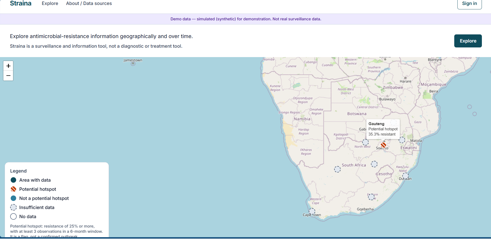
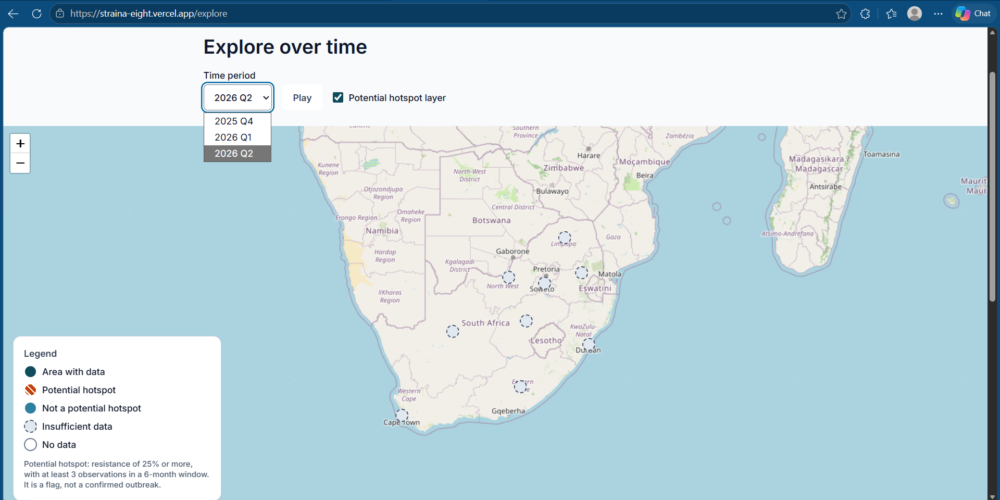
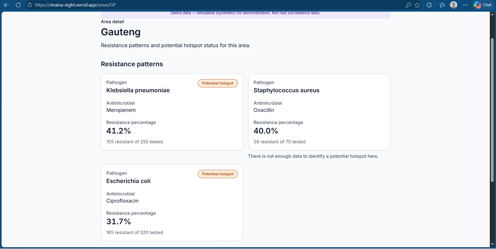
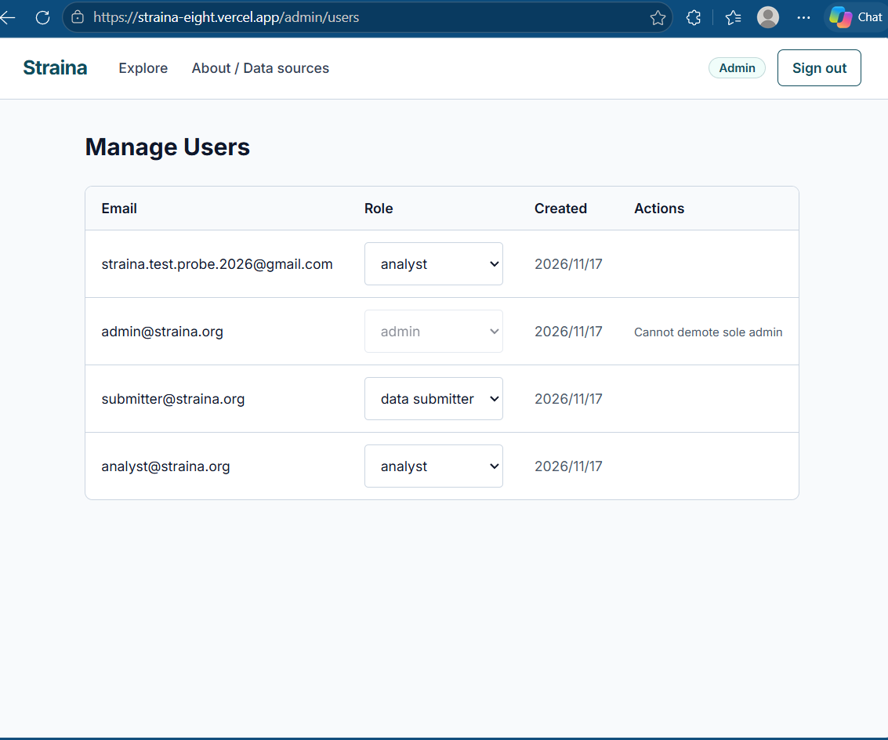
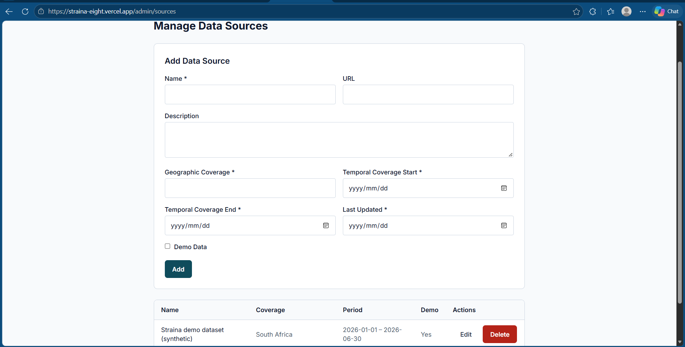

# Straina

**Straina is an antimicrobial-resistance (AMR) mapping platform that shows where drug-resistant organisms are emerging, how resistance patterns change over time, and which areas may become hotspots, so health teams can act earlier.**

> Straina is a surveillance and information tool. It is not a diagnostic or treatment tool. The demo uses simulated (synthetic) data, which is labelled as such in the app.

## The problem

Antimicrobial resistance is a major public-health concern, but the information is often spread across disconnected reports, datasets and dashboards that are hard to read. Straina presents AMR information on an interactive map with a time-based view, so people can see where resistance is observed, how it changes, and where closer attention may be needed.

## Links

| What | Link |
| --- | --- |
| Live app | [https://straina-eight.vercel.app/](https://straina-eight.vercel.app/) |
| Stitch designs | [Stitch project](https://stitch.google.com/projects/14278857879121820535) |
| Project board | [https://github.com/users/analystmodikwe/projects/8](https://github.com/users/analystmodikwe/projects/8) |
| Team Loom | LERATO: [Watch Loom](https://www.loom.com/share/8f2cdc4210f647e48ca8d64a966504fc)<br>GALALETSANG: [Watch Loom](https://www.loom.com/share/88ea39b5cbc44446b992553e7d200409)<br>LESEDI: [Watch Loom](https://www.loom.com/share/9ddf1e4c94304aabb1b9e2f33d06be53)<br>GARETH: _(to be added)_<br>THAMI: _(to be added)_ |
| PRD | [docs/PRD.md](docs/PRD.md) |
| Designs | [docs/designs/](docs/designs/) |
| Implementation plan | [IMPLEMENTATION_PLAN.md](IMPLEMENTATION_PLAN.md) |
| Team roles and timeline | [docs/team/README.md](docs/team/README.md) |

## Team & Roles

**Team Claude** (SNPL April Cohort 2026)

| Name | GitHub | Role(s) | Main features built |
| --- | --- | --- | --- |
| Lerato Thungo | [LeratoDaisy](https://github.com/LeratoDaisy) | Product Owner, Frontend, Backend | PRD; trends view (F2, F3); PRD alignment |
| Lesedi Modikwe | [analystmodikwe](https://github.com/analystmodikwe) | Tech Lead, Frontend, Backend | Architecture & CI; database migrations & RLS; Supabase auth API, S5 sign-in, S10 access denied, ProtectedRoute |
| Galaletsang Modise | [galaletsangmodise](https://github.com/galaletsangmodise) | Designer, Frontend, Backend | Stitch designs; map view (F1); S4 data sources / public explanation (F5, F6) |
| Gareth Motloutsi | [GarethMalekaMotloutsi](https://github.com/GarethMalekaMotloutsi) | QA / Test Lead, Frontend, Backend | Test plan; submit resistance records (in progress) |
| Thami Sithole | [ThamiRoneo](https://github.com/ThamiRoneo) | DevOps / Release, Frontend, Backend | CI/deployment; hotspot alerts (F4); S8 user management (F10); S9 source management (F11); offline hook |

Everyone writes code, opens PRs and reviews PRs. The "Main features built" column is updated as features are merged.

## Features

| Priority | Feature | Status |
| --- | --- | --- |
| Must | F1 Interactive AMR map (US1) | ✅ done |
| Must | F2 Time exploration (US2) | ✅ done |
| Must | F3 Resistance pattern exploration (US3) | ✅ done |
| Must | F4 Potential hotspot identification (US4, BR12) | ✅ done |
| Must | F5 Data source context (US5) | ✅ done |
| Should | F6 Public explanation layer | ✅ done |
| Must | F8 Sign-in and roles (US6, US7) | ✅ done |
| Must | F9 Record submission and management (US8, US9, US10) | 🚧 in progress |
| Must | F10 User and role management (US11) | ✅ done |
| Must | F11 Data source management (US12) | ✅ done |

✅ done · 🚧 in progress. The final feature list follows PRD v1.0.

## Screenshots

| S1: Home / Interactive AMR Map | S2: Time & Pattern Exploration |
|:---:|:---:|
|  |  |
| *National surveillance map showing resistance hotspots* | *Interactive time slider & pathogen/antibiotic filters* |

| S3: Location Detail | S8: Manage Users & Roles (Admin) |
|:---:|:---:|
|  |  |
| *Province-level breakdown & local observations* | *Role management (Admin, Data Submitter, Analyst)* |

| S9: Manage Data Sources (Admin) |
|:---:|
|  |
| *Surveillance dataset attribution & synthetic demo labeling* |

## Tech stack and architecture

| Layer | Technology |
| --- | --- |
| Frontend | React 19, TypeScript, Vite |
| Styling | Tailwind CSS 3.4 (design tokens from Stitch style guide) |
| Map | Leaflet 1.9 + React Leaflet with OpenStreetMap tiles |
| Backend, database and auth | Hosted Supabase: PostgreSQL, Supabase Auth, Row-Level Security |
| Testing | Vitest 5.1 + React Testing Library (80 tests passing across 17 test files) |
| CI | GitHub Actions |
| Hosting | Vercel (continuous deployment on main merges) |

```
User -> React web app (Vite) -> Supabase (Auth + Postgres with RLS) -> AMR data
```

The frontend talks to Supabase through the `supabase-js` client. Permissions are enforced in the database with Row-Level Security, not only in the screens.

## Run it locally

**Prerequisites:** Node.js 22 or newer (`node -v`), npm, Git.

```bash
git clone https://github.com/analystmodikwe/Straina.git
cd Straina
npm install
npm run dev
```

Then open the address shown in the terminal (usually http://localhost:5173).

**Environment variables:** copy `.env.example` to `.env` and fill in `VITE_SUPABASE_URL` and `VITE_SUPABASE_ANON_KEY`. Real keys are shared privately and `.env` is never committed.

**Database migrations and seed data:** migrations and synthetic demo seed are version-controlled in `supabase/migrations/` and applied to the hosted Supabase project.

## Test logins

Test accounts only, never real passwords. Use these credentials to test role-based access on the live app:

| Role | Email | Password | Access / Permissions |
|---|---|---|---|
| **Admin** | `admin@straina.org` | `Admin@Straina2026` | Full access: user management, data sources, and all observation records |
| **Data Submitter** | `submitter@straina.org` | `Submit@Straina2026` | Can submit new observations and manage their own records |
| **Analyst** | `analyst@straina.org` | `Analyst@Straina2026` | Read-only surveillance access across all public and analyst views |

## Tests

```bash
npm run lint
npm run typecheck
npm test
npm run build
```

These four checks also run automatically on every pull request (GitHub Actions). What the tests cover will be listed here as they are written.

## Deployment

Planned: the frontend on Vercel, connected to this repo so every merge to `main` redeploys. The database and auth run on a hosted Supabase project, and environment variables are set in the hosting dashboard, never in the repo.

## Known issues and next steps

- Features are still being built (see the board).
- The data is simulated; connecting a real authoritative data source is a future step.
- Ideas for later: more advanced analysis, CSV import, and a view of areas near a hotspot.

## How we work

- **`main` is protected.** No direct pushes. Every change goes through a pull request with at least 1 approval and a passing CI check.
- **Branches:** `feature/12-short-name`, `fix/15-short-name`, `chore/3-short-name` and `docs/2-short-name`, where the number is the Issue number.
- **Commits:** small and clear, like `feat: add record form (#12)`.
- **Pull requests:** describe what changed and why, include `Closes #12`, screenshots and how it was tested. Ask for a teammate as reviewer.
- **Reviews:** a teammate reads the code and approves or requests changes. Nobody approves or merges their own work without a review.
- **Merging:** squash and merge once approved and CI is green, then delete the branch.
- **Tasks:** every feature or phase is an Issue with acceptance criteria, an assignee and a label, tracked on the [project board](https://github.com/users/analystmodikwe/projects/8).
- **Secrets:** never commit `.env`. Only `.env.example` is committed.
