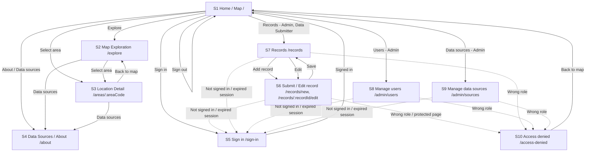

# STRAINA — PRODUCT REQUIREMENTS DOCUMENT

**Document Status:** v1.0 Approved
**Version:** 1.0
**Date:** 11 Nov 2026
**Product Name:** Straina
**Author(s):** Lerato Thungo (Team Claude)
**Student Number:** SNPL2026
**Course / Cohort:** SNPL APRIL COHORT 2026
**Facilitator / Reviewer:** Mnelisi Maswanganyi
**Platform:** Web Application
**Technology (current repository):** React + TypeScript + Vite (see 12.1 for what is and is not installed yet)
**Original App Idea Link:** Not provided yet
**Repository:** https://github.com/analystmodikwe/Straina
**PRD location:** `docs/PRD.md` (confirmed: the repository README links to this path)

**Team Claude (from the repository README, checked 11 Nov 2026):**

| Name | Role(s) |
|---|---|
| Lerato Thungo | Product Owner, Frontend, Backend |
| Lesedi Modikwe | Tech Lead, Frontend, Backend |
| Galaletsang Modise | Designer, Frontend, Backend |
| Gareth Motloutsi | QA / Test Lead, Frontend, Backend |
| Thami Sithole | DevOps / Release, Frontend, Backend |

**Repository facts verified on 11 Nov 2026:** `docs/PRD.md` exists; `package.json` lists React 19, Vite, TypeScript, Vitest and ESLint only; the README marks F1–F7, Tailwind, Leaflet, Supabase and Vercel as planned; `.env.example`, migrations, `IMPLEMENTATION_PLAN.md` and the Stitch designs link are "to be added". **Not verifiable** (GitHub blocked access): `src/`, `docs/designs/`, `docs/team/`, issues and pull requests.

> **How to read "Proposed".** Anything marked **Proposed:** is a starting point that the team has not yet confirmed. Lerato has the final say on scope. Every Proposed item is listed in Section 32 so nothing is hidden. Nothing marked Proposed may be treated as decided during implementation until it is confirmed and this PRD is updated.

---

## CHANGE LOG

| Version | Date | Section | What changed | Why | Who |
|---|---|---|---|---|---|
| 1.0 | 11 Nov 2026 | Header | Replaced "Version 1.0 / Draft" with "v1.0 final draft candidate — ready for team review"; added date; set repository link; recorded PRD path `docs/PRD.md`. | Header said 1.0 but content was a first draft (instructions part 1). | Lerato Thungo (Product Owner), AI-assisted; pending team review |
| 1.0 | 11 Nov 2026 | Header | Added the team roster and a list of repository facts verified, and of what could not be verified. | Shows what is confirmed from GitHub and what is not. | Same |
| 1.0 | 11 Nov 2026 | Change Log (new) | Added this Change Log. | Required by instructions part 1. | Same |
| 1.0 | 11 Nov 2026 | 3.1 (G5) | Reworded G5 to "core read-only experience" and noted the dependency on OQ10. ID unchanged. | G5 ("without requiring an account") must agree with Section 8 now that accounts exist. | Same |
| 1.0 | 11 Nov 2026 | 3.2 | Objective 4 now allows labelled demo data for the MVP; objective 5 now points to BR12 instead of an "approved methodology". | Remove contradiction between "real data" and the demo-data decision; hotspot rule now exists. | Same |
| 1.0 | 11 Nov 2026 | 4.2 | Added that read-only access is public (Proposed) and that signed-in roles exist. | Consistency with Section 8. | Same |
| 1.0 | 11 Nov 2026 | 5 (US1–US5) | Kept US1–US5. Added a test ID (T-USn-m) to every acceptance criterion. Reworded the US1 "no fabricated data" criterion, the US4 methodology criterion and added demo-label wording where needed. | Gareth writes one test per criterion; the old wording contradicted the demo-data decision. | Same |
| 1.0 | 11 Nov 2026 | 5 (US6–US13) | Added US6–US13 for sign-in, sign-out, submit, edit, delete, user/role management, data-source management and recognising demo data. | Instructions part 4 (user stories). | Same |
| 1.0 | 11 Nov 2026 | 6 (F4) | F4 now points to a written rule (BR12) with named parameters. Parameter values are not yet decided. F7 marked Proposed as a non-goal (see Section 30). IDs unchanged. | Instructions part 1 (hotspot rule) and part 4 (non-goals). | Same |
| 1.0 | 11 Nov 2026 | 6 (F8–F11) | Added F8 Sign-in and roles, F9 Record submission and management, F10 User and role management, F11 Data source management. | The accounts decision needs features with IDs so stories and screens can link to them. | Same |
| 1.0 | 11 Nov 2026 | 7 (BR1) | BR1 reworded: production data from an approved source; labelled demo data allowed for the MVP. ID unchanged. | Contradiction between BR1/Section 11/Section 25 and the demo-data decision. | Same |
| 1.0 | 11 Nov 2026 | 7 (BR6–BR13) | Added BR6–BR11 (view, add, edit, delete, manage users, manage data sources), BR12 (potential hotspot rule), BR13 (demo data labelling). BR3 unchanged. | Instructions part 1 and part 3. | Same |
| 1.0 | 11 Nov 2026 | 8 | Replaced "no accounts" with Supabase Auth, roles Admin / Data Submitter / Analyst, a permissions table with test IDs, public vs signed-in areas, and sign-in, sign-out, permission-denied, protected-page and session-expiry behaviour. | The previous text contradicted the brief and the roles decision. | Same |
| 1.0 | 11 Nov 2026 | 9 | Kept Flows 1–3. Added Flows 4–9: sign-in, sign-out, permission denied / protected page, submit record, edit or delete record, session expiry. | Instructions part 4 (flows). | Same |
| 1.0 | 11 Nov 2026 | 10 | Kept S1–S4 and M1. Added S5–S10 with route, access, redirect and all states per screen. Added a navigation map (10.1) and an access summary (10.2). | Instructions part 4 (screens). | Same |
| 1.0 | 11 Nov 2026 | 11 | Replaced "may include" lists with proposed tables and fields, types and relationships; described demo (seed) data, how it is loaded and how it is labelled. "Fabricated data" rule replaced by the demo-data rule. | Instructions part 1 (data). | Same |
| 1.0 | 11 Nov 2026 | 12 | Filled in architecture decisions as Proposed (Supabase, Postgres, RLS, Leaflet, OpenStreetMap, Vercel). Replaced placeholder environment variables with Proposed names. Stated that the service-role key is never used in the browser. | Instructions part 1 (technical). | Same |
| 1.0 | 11 Nov 2026 | 13 | Expanded security: Supabase Auth, role-based access, row-level security, no secrets in the repository, service-role key. | Instructions part 4. | Same |
| 1.0 | 11 Nov 2026 | 14 | Rewrote privacy: accounts now exist; account email and role are the personal data stored; demo data holds no real personal data. | Contradiction with "no accounts"; instructions part 4. | Same |
| 1.0 | 11 Nov 2026 | 15 | Accessibility target set to Proposed WCAG 2.1 level AA. | Instructions OQ8. | Same |
| 1.0 | 11 Nov 2026 | 16 | Kept all existing error messages. Added IDs ERR1–ERR6 to them and added ERR7–ERR13 for sign-in, session, permission and save errors (copy is Proposed). | Instructions part 4 (errors). | Same |
| 1.0 | 11 Nov 2026 | 17 | Gave every quality requirement an ID (QR1–QR13). | Tests must be able to point to each one. | Same |
| 1.0 | 11 Nov 2026 | 18 | Replaced the TBD list with what is known and with the Proposed source (`docs/designs/` plus a style guide). Values that could not be verified are listed in Section 32. | Instructions part 4 (design). | Same |
| 1.0 | 11 Nov 2026 | 19 | Reworded the synthetic-data rule so labelled demo data is allowed. | Contradiction with the demo-data decision. | Same |
| 1.0 | 11 Nov 2026 | 21 | Added Risk 6 (demo data mistaken for real data) and Risk 7 (permissions enforced only on screen). Risks 1–5 unchanged. | New decisions create new risks. | Same |
| 1.0 | 11 Nov 2026 | 22 | Updated assumptions 1, 2, 5 and added assumptions 6–8. | Assumptions must reflect the new decisions. | Same |
| 1.0 | 11 Nov 2026 | 23 | Added an answer, status and confirming person to OQ1–OQ9. Added OQ10 and OQ11. | Instructions part 1 and part 2. | Same |
| 1.0 | 11 Nov 2026 | 24 | Updated milestone statuses using only what the repository shows. | Instructions part 4. | Same |
| 1.0 | 11 Nov 2026 | 25 | Reworded MVP: labelled synthetic demo data; read-only public access (Proposed); sign-in and roles. | Contradiction with the demo-data and accounts decisions. | Same |
| 1.0 | 11 Nov 2026 | 28 | Rewrote the submission checklist to match v1.0 requirements. | Instructions part 4. | Same |
| 1.0 | 11 Nov 2026 | 29 | Section now lists only genuinely unresolved items. | Instructions part 1. | Same |
| 1.0 | 11 Nov 2026 | 30 (new) | Added Non-Goals. F7 kept with its ID and marked Proposed as not built in v1. | Instructions part 4. | Same |
| 1.0 | 11 Nov 2026 | 31 (new) | Added Edge Cases EC1–EC10 with test IDs. | Instructions part 4. | Same |
| 1.0 | 11 Nov 2026 | 32 (new) | Added Remaining Questions / Proposed Decisions, including contradictions found. | Instructions part 1 rule 6. | Same |
| 1.0 | 12 Nov 2026 | Header | Status changed to "v1.0 Approved"; version kept as 1.0. | Approval of v1.0 for submission. | Lerato Thungo (Product Owner), AI-assisted |
| 1.0 | 12 Nov 2026 | 23 (OQ2) | OQ2 marked Answered / Approved: `HOTSPOT_THRESHOLD_PCT = 25.0%`, `HOTSPOT_MIN_OBSERVATIONS = 3`, `HOTSPOT_WINDOW_MONTHS = 6`. | Hotspot rule values decided. | Lerato Thungo (Product Owner), AI-assisted |
| 1.0 | 12 Nov 2026 | 23 (OQ5) | OQ5 marked Answered / Approved: adopt Galaletsang's `docs/designs/style-guide.md`. | Design system decided. | Lerato Thungo (Product Owner), AI-assisted |
| 1.0 | 12 Nov 2026 | 23 (OQ10) | OQ10 marked Answered / Approved: public read-only access confirmed. | Map access decided. | Lerato Thungo (Product Owner), AI-assisted |
| 1.0 | 12 Nov 2026 | 23 (OQ11) | OQ11 marked Answered / Approved: admin-managed accounts in v1; no visitor self-registration. | Account model decided. | Lerato Thungo (Product Owner), AI-assisted |
| 1.0 | 12 Nov 2026 | 32 | OQ2, OQ5, OQ10 and OQ11 marked Answered / Approved in 32.1 and 32.2; contradiction note 10 updated. | Section 32 must match Section 23. | Lerato Thungo (Product Owner), AI-assisted |
| 1.0 | 12 Nov 2026 | 6 (F4), 7 (BR12) | Replaced "values not yet decided" with the approved OQ2 values; BR12 title updated. Rule logic unchanged. | Remove contradiction with approved OQ2. | Lerato Thungo (Product Owner), AI-assisted |
| 1.0 | 12 Nov 2026 | 3.1 (G5), 4.2, 7 (BR6), 8.2, 8.3, 25 | Removed "Proposed / depends on OQ10" wording; public read-only access stated as confirmed. T-PERM-1b noted as having no denied case. | Remove contradiction with approved OQ10. | Lerato Thungo (Product Owner), AI-assisted |
| 1.0 | 12 Nov 2026 | 8.4 | "Who can create an account" now states admin-managed accounts, no visitor self-registration. Default role and password reset left as they were. | Match approved OQ11. | Lerato Thungo (Product Owner), AI-assisted |
| 1.0 | 12 Nov 2026 | 18 | Design source now the adopted `docs/designs/style-guide.md`; "Pending style guide" replaced. Values not copied. | Match approved OQ5. | Lerato Thungo (Product Owner), AI-assisted |
| 1.0 | 12 Nov 2026 | 24 (Milestone M1), 29 | Milestone M1 status and Section 29 status set to Approved; resolved items removed from the unresolved list. | Match approved status. | Lerato Thungo (Product Owner), AI-assisted |

---

## 1. PRODUCT OVERVIEW

### 1.1 Product Name

Straina

### 1.2 Product Description

> An intelligent antimicrobial-resistance mapping platform that visualises where drug-resistant organisms are emerging, tracks how resistance patterns change over time, and identifies potential hotspots before they become larger public-health threats.

### 1.3 Product Vision

Straina aims to make antimicrobial-resistance information easier to understand by transforming complex surveillance information into an interactive geographic and time-based experience.

The platform will allow users to explore where antimicrobial resistance is observed, how resistance patterns change over time, and which areas may require closer attention.

### 1.4 Product Purpose

The purpose of Straina is to provide an accessible web-based way to explore antimicrobial-resistance information geographically and over time.

The platform is intended to support understanding and surveillance of antimicrobial resistance. It is **not** intended to provide individual medical diagnoses or treatment recommendations. Straina is a surveillance and information tool, not a diagnostic or treatment tool.

### 1.5 Platform

Straina will be developed as a web application.

The current repository uses React, TypeScript, Vite, React DOM, and Vitest. The current repository is a project reference and does not yet represent the final MVP documented in this PRD.

---

## 2. PROBLEM STATEMENT

Antimicrobial resistance (AMR) is a major public-health concern, but information about resistance can be difficult to understand when it is distributed across reports, datasets, technical surveillance information, and different information sources.

There is a need for an accessible way to understand:

- Where resistance is being observed.
- How resistance patterns change over time.
- What resistance patterns are being observed.
- Which areas may require closer attention.

Straina addresses this problem by providing an interactive map and time-based exploration experience for AMR surveillance information.

Straina is not a medical diagnostic or treatment system.

---

## 3. GOALS AND OBJECTIVES

### 3.1 Goals

**G1 — Geographic Visibility**
Help users understand where AMR information is being reported.

**G2 — Temporal Understanding**
Allow users to explore how resistance patterns change over time.

**G3 — Data Transparency**
Provide information about the sources and context of the data being displayed.

**G4 — Potential Hotspot Identification**
Identify areas that meet the documented definition of a potential AMR hotspot (BR12).

**G5 — Inclusive Access**
Make the core read-only experience (map, time view, patterns, potential hotspots and data sources) accessible without requiring an account (public read-only access confirmed, OQ10).

### 3.2 Objectives

Straina should:

1. Provide an interactive AMR map.
2. Allow geographic exploration of AMR information.
3. Allow exploration of AMR information over time.
4. Use real, attributable data for the production experience. For the MVP, use clearly labelled synthetic demo data (BR13), never presented as real surveillance data.
5. Identify potential hotspots using the rule in BR12.
6. Provide information about data sources.
7. Clearly communicate data limitations.
8. Avoid providing medical advice.
9. Make the experience understandable to both specialist and non-specialist users.

---

## 4. TARGET USERS / PERSONAS

### 4.1 Primary User

**Public-health / AMR surveillance professional**

The primary user is a public-health or antimicrobial-resistance surveillance professional who needs to understand where resistance occurs, how resistance patterns change, and which areas may require further investigation.

The choice of primary user is based on the role of AMR surveillance in supporting the understanding of resistance patterns and public-health action.

### 4.2 Secondary Users

- Researchers
- Healthcare professionals
- Policymakers and public-health decision makers
- General public

The general public can access the core read-only Straina experience without creating an account (public read-only access confirmed, OQ10). Signed-in roles (Admin, Data Submitter, Analyst — Section 8) are needed only for adding, changing or managing data and users, and for any area the team later decides to restrict.

The interface should avoid unnecessary technical language so that important information can be understood by non-specialist users.

---

## 5. USER STORIES

Every acceptance criterion has a test ID (T-USn-m). One test is written per criterion. Where a criterion depends on a Proposed decision, the decision is named.

### US1 — Explore AMR Map

**As a public user, I want to explore an AMR map so that I can understand where resistance is being reported.**

#### Acceptance Criteria

- **T-US1-1:** The map is visible.
- **T-US1-2:** Geographic AMR information is represented.
- **T-US1-3:** A legend or explanation is available.
- **T-US1-4 (unhappy):** An appropriate error state (ERR3) is shown if data cannot load.
- **T-US1-5:** No fabricated AMR data is displayed as real data. Demo data is shown only with the demo label required by BR13.

### US2 — Explore AMR Over Time

**As a surveillance user, I want to change the time period so that I can understand how resistance patterns change over time.**

#### Acceptance Criteria

- **T-US2-1:** The user can select a time period.
- **T-US2-2:** The displayed data updates according to the selected period.
- **T-US2-3 (unhappy):** A clear no-data state (ERR2) is shown when information is unavailable.
- **T-US2-4:** Missing data is not treated as zero.

### US3 — Inspect Resistance Patterns

**As an analyst, I want to inspect a selected geographic area so that I can understand the resistance information associated with that area.**

#### Acceptance Criteria

- **T-US3-1:** The user can select an area.
- **T-US3-2:** Relevant resistance information is displayed.
- **T-US3-3:** The source and context of the information are available.
- **T-US3-4 (unhappy):** A clear no-data state (ERR2) is shown when appropriate.

### US4 — Identify Potential Hotspots

**As a surveillance user, I want potential hotspots to be highlighted so that I can identify areas that may require closer attention.**

#### Acceptance Criteria

- **T-US4-1:** The hotspot rule is defined in BR12 before the hotspot layer is built.
- **T-US4-2:** Areas meeting the BR12 rule are highlighted.
- **T-US4-3 (unhappy):** Areas with insufficient data are not flagged and show ERR5.
- **T-US4-4:** Potential hotspots are labelled "potential hotspot" and are not presented as confirmed outbreaks.

### US5 — Understand Data Sources

**As a user, I want to understand where the information comes from so that I can evaluate the context and credibility of the data.**

#### Acceptance Criteria

- **T-US5-1:** The data source is identifiable.
- **T-US5-2:** Relevant update information is available.
- **T-US5-3:** Geographic and temporal coverage can be understood.
- **T-US5-4 (unhappy):** A record with no linked data source is not displayed as surveillance information.

### US6 — Sign In

**As a registered user (Admin, Data Submitter or Analyst), I want to sign in so that I can use the features my role allows.**

#### Acceptance Criteria

- **T-US6-1:** Given a registered user, when they submit a correct email and password on S5, then they are signed in and taken to S1 (or to the page they originally asked for, if their role may open it).
- **T-US6-2 (unhappy):** Given an incorrect email or password, when they submit S5, then ERR7 is shown and they stay on S5.
- **T-US6-3 (unhappy):** Given an empty email or password, when they submit S5, then the field-level message ERR13 is shown and no sign-in request is sent.
- **T-US6-4 (unhappy):** Given a signed-in session that has expired, when the user opens or acts on a signed-in page, then they are sent to S5 and ERR8 is shown.

### US7 — Sign Out

**As a signed-in user, I want to sign out so that nobody else can use my account on this device.**

#### Acceptance Criteria

- **T-US7-1:** Given a signed-in user, when they choose "Sign out", then the session ends and they land on S1.
- **T-US7-2 (unhappy):** Given a user who has just signed out, when they press the browser Back button to a signed-in page (S6–S9), then they are sent to S5 and no protected data is shown.

### US8 — Submit a Resistance Record

**As a Data Submitter (or Admin), I want to add a new resistance record so that the map and time view include new observations.**

#### Acceptance Criteria

- **T-US8-1:** Given a Data Submitter on S6, when they complete all required fields (11.1) with valid values and save, then the record is stored with them as its creator and a success message is shown.
- **T-US8-2 (unhappy):** Given a required field is empty, when they save, then the record is not stored and ERR13 is shown beside that field.
- **T-US8-3 (unhappy):** Given `isolates_resistant` is greater than `isolates_tested`, when they save, then the record is not stored and ERR14 is shown.
- **T-US8-4 (unhappy):** Given an Analyst or a visitor, when they open `/records/new`, then they cannot see the form (visitor → S5; Analyst → S10).
- **T-US8-5 (unhappy):** Given an Analyst or a visitor, when a record insert is sent directly to the database, then the database rejects it (BR7).

### US9 — Edit a Record

**As a Data Submitter, I want to edit records I created so that I can correct mistakes. As an Admin, I want to edit any record.**

#### Acceptance Criteria

- **T-US9-1:** Given a Data Submitter and a record they created, when they change a field and save, then the change is stored and a success message is shown.
- **T-US9-2 (unhappy):** Given a Data Submitter and a record created by someone else, when they try to edit it (screen or direct request), then it is refused (BR8) and ERR11 is shown.
- **T-US9-3:** Given an Admin, when they edit any record, then the change is stored.
- **T-US9-4 (unhappy):** Given an Analyst, when they open S7, then no Edit control is shown and a direct update is rejected by the database.

### US10 — Delete a Record

**As a Data Submitter, I want to delete records I created. As an Admin, I want to delete any record.**

#### Acceptance Criteria

- **T-US10-1:** Given a Data Submitter and a record they created, when they confirm "Delete", then the record is removed from S7, S1, S2 and S3.
- **T-US10-2 (unhappy):** Given a Data Submitter and a record created by someone else, when they try to delete it (screen or direct request), then it is refused (BR9) and ERR11 is shown.
- **T-US10-3:** Given an Admin, when they confirm "Delete" on any record, then the record is removed.
- **T-US10-4 (unhappy):** Given the user cancels the delete confirmation, then the record is not removed.

### US11 — Manage Users and Roles

**As an Admin, I want to view users and change their roles so that each person can do only what their job needs.**

#### Acceptance Criteria

- **T-US11-1:** Given an Admin on S8, when they change a user's role to Admin, Data Submitter or Analyst and save, then the new role applies the next time that user loads a page.
- **T-US11-2 (unhappy):** Given a Data Submitter, an Analyst or a visitor, when they open `/admin/users`, then they cannot see it (visitor → S5; others → S10).
- **T-US11-3 (unhappy):** Given a non-Admin, when a role change is sent directly to the database, then the database rejects it (BR10).

### US12 — Manage Data Sources

**As an Admin, I want to add and change data sources so that every record can be attributed.**

#### Acceptance Criteria

- **T-US12-1:** Given an Admin on S9, when they save a new data source with the required fields (11.2), then it appears in the S9 list and in the S6 source selector.
- **T-US12-2 (unhappy):** Given a non-Admin, when they open `/admin/sources`, then they cannot see it (visitor → S5; others → S10).
- **T-US12-3 (unhappy):** Given a non-Admin, when a data-source change is sent directly to the database, then the database rejects it (BR11).

### US13 — Recognise Demo Data

**As any user, I want demo data to be clearly labelled so that I never mistake it for real surveillance information.**

#### Acceptance Criteria

- **T-US13-1:** Given any displayed record whose data source is marked demo, when S1, S2, S3 or S4 is shown, then the demo notice text from BR13 is visible on that screen.
- **T-US13-2:** Given a data source marked demo, when S4 or S9 lists it, then it is labelled "Demo (synthetic)".
- **T-US13-3 (unhappy):** Given a record linked to a demo source, when it is displayed anywhere, then no text describes it as real surveillance data.

---

## 6. FEATURES AND REQUIREMENTS

### F1 — Interactive AMR Map

**Priority:** Must Have

The platform must provide an interactive map for exploring AMR information geographically.

### F2 — Time Exploration

**Priority:** Must Have

Users must be able to explore AMR information across available time periods.

### F3 — Resistance Pattern Exploration

**Priority:** Must Have

Users must be able to inspect resistance information associated with selected geographic areas.

### F4 — Potential Hotspot Identification

**Priority:** Must Have

The platform must identify potential hotspots using the rule written in BR12. The rule has three named parameters (threshold, minimum number of observations, time window). The approved values are `HOTSPOT_THRESHOLD_PCT = 25.0%`, `HOTSPOT_MIN_OBSERVATIONS = 3` and `HOTSPOT_WINDOW_MONTHS = 6` (OQ2).

### F5 — Data Source Context

**Priority:** Must Have

The platform must provide information about the source and context of displayed data.

### F6 — Public Explanation Layer

**Priority:** Should Have

The platform should explain AMR-related information in language that can be understood by non-specialist users.

### F7 — Advanced Analysis

**Priority:** Should Have (previous draft). **Proposed:** not built in v1 — moved to Non-Goals (Section 30). ID kept. Awaiting Lerato's scope decision.

### F8 — Sign-in and Roles

**Priority:** Must Have (**Proposed**)

Users sign in with Supabase Auth. Each account has one role: Admin, Data Submitter or Analyst. Permissions follow Section 8 and are enforced by the database (row-level security), not only on screen.

### F9 — Record Submission and Management

**Priority:** Must Have (**Proposed**)

Admins and Data Submitters can add resistance records. Admins can edit or delete any record; Data Submitters can edit or delete only records they created.

### F10 — User and Role Management

**Priority:** Must Have (**Proposed**)

Admins can see users and change their roles.

### F11 — Data Source Management

**Priority:** Must Have (**Proposed**)

Admins can add and change data sources.

> **Proposed:** F8–F11 are added because the roles table needs features to attach stories and screens to. Lerato confirms their priority; the original template limit is 3 to 5 Must features, so F9–F11 may be reduced to Should or moved to a later version if scope must shrink (listed in Section 32).

---

## 7. BUSINESS RULES

**BR1:** Production data must come from an approved and documented source. For the MVP, clearly labelled synthetic demo data (BR13) is allowed in place of production data.

**BR2:** Displayed production data must retain appropriate attribution. Every displayed record shows its data source.

**BR3:** A hotspot is a visual flag based on a documented methodology and must not automatically be interpreted as a confirmed outbreak.

**BR4:** Straina must not provide individual treatment recommendations.

**BR5:** Unavailable data must be explicitly represented. Missing data must not be interpreted as zero.

**BR6 — Who may view data (public read-only access confirmed, OQ10):** Anyone, including a visitor who is not signed in, may view the map, time view, resistance patterns, potential hotspots and data sources. Viewing is read-only. *Test:* T-PERM-1a, T-PERM-1b.

**BR7 — Who may add data:** Only a signed-in Admin or Data Submitter may add a resistance record. Analysts and visitors may not. *Test:* T-PERM-2a, T-PERM-2b.

**BR8 — Who may edit data:** An Admin may edit any record. A Data Submitter may edit only records they created. An Analyst and a visitor may not edit. *Test:* T-PERM-3a, T-PERM-3b.

**BR9 — Who may delete data:** An Admin may delete any record. A Data Submitter may delete only records they created. An Analyst and a visitor may not delete. *Test:* T-PERM-3a, T-PERM-3b.

**BR10 — Who may manage users:** Only an Admin may view the user list and change roles. *Test:* T-PERM-4a, T-PERM-4b.

**BR11 — Who may manage data sources:** Only an Admin may add or change data sources. *Test:* T-PERM-5a, T-PERM-5b.

**BR12 — Potential hotspot rule (parameter values approved, OQ2; per pathogen–antimicrobial scope still Proposed):**
For one pathogen and antimicrobial combination (**Proposed**), an area is shown as a **potential hotspot** when **both** conditions are true for the selected time window:
1. The number of observation records for that area in the window is **greater than or equal to** `HOTSPOT_MIN_OBSERVATIONS`.
2. The resistance percentage for that area, calculated as (sum of `isolates_resistant` ÷ sum of `isolates_tested`) × 100 across those records, is **greater than or equal to** `HOTSPOT_THRESHOLD_PCT`.

The time window is `HOTSPOT_WINDOW_MONTHS` months ending on the last day of the selected time period.
- If condition 1 fails but at least one record exists, the area is **not** flagged and shows ERR5 (insufficient data).
- If no records exist, the area shows ERR2 (no data) and is not treated as zero (BR5).
- The wording is always "potential hotspot", never "confirmed outbreak" (BR3).
- **Approved values (OQ2):** `HOTSPOT_THRESHOLD_PCT = 25.0%`; `HOTSPOT_MIN_OBSERVATIONS = 3`; `HOTSPOT_WINDOW_MONTHS = 6`.

**BR13 — Demo data labelling:** A record whose data source is marked `is_demo = true` is demo (synthetic) data. Wherever demo data is displayed, the screen shows the notice: **"Demo data — simulated (synthetic) for demonstration. Not real surveillance data."** (**Proposed** wording.) Demo data is never described as real. *Test:* T-US13-1 to T-US13-3.

---

## 8. ACCOUNTS AND SIGN-IN

**Replaces the previous "no accounts" decision.** Version 1 uses **Supabase Auth** for sign-in. This is **Proposed** in the v1.0 instructions and the repository README lists Supabase Auth as planned; it is not yet built.

### 8.1 Roles

| Role | Description |
|---|---|
| Admin | Manages users, roles and data sources; can add, edit and delete any record. |
| Data Submitter | Adds records; edits and deletes only records they created. |
| Analyst | Views data only. |
| Visitor (not signed in) | **Proposed:** can view the read-only parts of the app (BR6). Not a role; has no account. |

Each account has exactly one role, stored with the account's profile (11.3).

### 8.2 Permissions table (Proposed — Lerato and Lesedi confirm)

Every row becomes two tests: one allowed, one denied.

| Action | Admin | Data Submitter | Analyst | Visitor (not signed in) | Test IDs |
|---|---|---|---|---|---|
| View the map, time view, patterns, hotspots and data sources | Yes | Yes | Yes | Yes (confirmed, OQ10) | T-PERM-1a (allowed), T-PERM-1b (no denied case: public read-only access is confirmed) |
| Add a new resistance record | Yes | Yes | No | No | T-PERM-2a, T-PERM-2b |
| Edit or delete a record | Yes (any) | Own records only | No | No | T-PERM-3a, T-PERM-3b |
| Manage users and roles | Yes | No | No | No | T-PERM-4a, T-PERM-4b |
| Manage data sources | Yes | No | No | No | T-PERM-5a, T-PERM-5b |

Every "No" is enforced by the database through row-level security (Section 12), not only by hiding buttons.

### 8.3 Public vs signed-in areas (confirmed, OQ10)

| Area | Screens | Access |
|---|---|---|
| Public (no account needed) | S1, S2, S3, S4, S5 (sign-in page) | Everyone. S5 is open to visitors; a signed-in user who opens S5 is sent to S1. |
| Signed-in, Admin or Data Submitter | S6, S7 | Admin and Data Submitter only. |
| Signed-in, Admin only | S8, S9 | Admin only. |
| Signed-in, any role | S10 | Shown only to a signed-in user who opened a screen their role may not open. |

**OQ10 (answered / approved):** Public read-only access is confirmed. S1–S4 are open to everyone; the text above, Section 3 (G5), Section 4.2, Section 9, Section 10, Section 25 and the acceptance criteria are consistent with it.

### 8.4 Account decisions

| Decision | Answer |
|---|---|
| Sign-in method | Email and password through Supabase Auth (**Proposed**, OQ11). |
| Who can create an account | Admin-managed accounts in v1. No visitor self-registration (OQ11, approved). |
| Default role | Not decided (OQ11). |
| Password reset | Not decided (OQ11). |
| Session | Supabase session. Length before re-sign-in: not decided; default Supabase behaviour assumed (listed in Section 32). |
| Sign out | A "Sign out" control in the header on every screen when signed in. No confirmation. |
| Personal data held | Account email and role (14). |

### 8.5 Sign-in, sign-out, permission denied and protected-page behaviour

- **Sign-in:** the user opens S5, enters email and password, and submits. Success → S1, or the originally requested page if the user's role may open it. Failure → ERR7 on S5. (Flow 4.)
- **Sign-out:** "Sign out" ends the session and goes to S1. Pressing Back must not show protected data. (Flow 5.)
- **Unauthenticated user opens a protected screen (S6–S9, S10):** redirected to S5. (Flow 6.)
- **Wrong role (signed in):** redirected to S10, which shows ERR9. (Flow 6.)
- **Session expires:** the next protected page load or save attempt redirects to S5 and shows ERR8. Unsaved form input is not kept (**Proposed**). (Flow 9.)

---

## 9. USER FLOWS

### Flow 1 — Explore AMR Map

1. User opens Straina.
2. User sees the AMR map.
3. User explores geographic information.
4. User selects an area.
5. Straina displays available information for the selected area.
6. User returns to the map.

### Flow 2 — Explore Changes Over Time

1. User opens the map.
2. User selects a time period.
3. Straina updates the displayed information.
4. User compares available information across periods.
5. Straina displays a no-data state where information is unavailable.

### Flow 3 — Explore Potential Hotspots

1. User opens the map.
2. User enables or views the potential hotspot layer.
3. Straina highlights areas meeting the BR12 rule.
4. User selects a highlighted area.
5. Straina displays the available supporting information and context.

### Flow 4 — Sign In

Starts when: a visitor selects "Sign in" or is redirected to S5.
1. S5 Sign in: user enters email and password and selects "Sign in".
2. If either field is empty → ERR13 beside the field; no request is sent.
3. If Supabase rejects the credentials → ERR7; user stays on S5.
4. Otherwise → the user is signed in and goes to the page they originally requested (if their role may open it) or S1.
Ends when: the user sees S1 (or the requested page) with "Sign out" in the header.

### Flow 5 — Sign Out

1. Signed-in user selects "Sign out" in the header.
2. Session ends.
3. User lands on S1 as a visitor.
4. If the user presses Back to a protected page → redirected to S5 (Flow 6).

### Flow 6 — Protected Page and Permission Denied

1. A user opens a protected route (S6–S10).
2. If the user is not signed in → redirect to S5; after sign-in, if the role may open the page, go there; otherwise go to S10.
3. If the user is signed in but the role may not open it → redirect to S10, which shows ERR9 and a "Back to map" button → S1.
4. If the role may open it → the screen loads.

### Flow 7 — Submit a Resistance Record

Starts when: an Admin or Data Submitter wants to add an observation.
1. S1 or S7: user selects "Add record" → S6.
2. S6 Submit record: user selects a data source and fills the fields (11.1).
3. If a required field is empty → ERR13; if `isolates_resistant` > `isolates_tested` → ERR14; the record is not saved.
4. If offline → ERR1, "Save" disabled.
5. If the save fails on the server → ERR12; the entered values stay in the form.
6. Otherwise → success message "Record saved." and the user goes to S7.
Ends when: the new record appears in S7 and in the map data.

### Flow 8 — Edit or Delete a Record

1. S7 Records: user finds a record. "Edit" and "Delete" appear only where the role allows (BR8, BR9).
2. Edit: "Edit" → S6 (edit mode) → change fields → "Save" → success "Record saved." → S7.
3. Delete: "Delete" → confirmation "Delete this record? This cannot be undone." → "Delete" confirms → success "Record deleted." → S7; "Cancel" leaves the record.
4. If a Data Submitter attempts to edit or delete another person's record (direct request) → refused by the database → ERR11.
5. If the session has expired → Flow 9.

### Flow 9 — Session Expiry

1. A user with an expired session opens a protected page or presses "Save" or "Delete".
2. Straina redirects to S5 and shows ERR8.
3. After signing in again, the user goes to S1 (**Proposed**: unsaved form input is not restored).

---

## 10. SCREEN INVENTORY

**Proposed:** all routes below. The repository `package.json` does not yet include a router and I could not read `src/`, so no existing routes could be confirmed. If `src/` already defines different routes, the routes below must be changed to match.

**Notes on IDs.** "M1" is used in this document for the **screen-state set** below and also for **Milestone M1** (Section 24). Both IDs are kept as they were in the first draft; they are always written "Screen M1" or "Milestone M1". See Section 32.

### 10.1 Navigation Map



### 10.2 Access Summary (Proposed)

| ID | Screen | Route | Who can open it | Who cannot open it | Redirect for those who cannot |
|---|---|---|---|---|---|
| S1 | Home / Map | `/` | Everyone | — | — |
| S2 | Map Exploration | `/explore` | Everyone | — | — |
| S3 | Location Detail | `/areas/:areaCode` | Everyone | — | — |
| S4 | Data Sources / About | `/about` | Everyone | — | — |
| S5 | Sign in | `/sign-in` | Visitors | Signed-in users | Signed-in user → S1 |
| S6 | Submit / Edit record | `/records/new`, `/records/:recordId/edit` | Admin; Data Submitter (edit mode only for own records) | Analyst; visitor; Data Submitter on another person's record | Visitor → S5; signed-in wrong role → S10 |
| S7 | Records | `/records` | Admin; Data Submitter | Analyst; visitor | Visitor → S5; Analyst → S10 |
| S8 | Manage users and roles | `/admin/users` | Admin | Data Submitter; Analyst; visitor | Visitor → S5; others → S10 |
| S9 | Manage data sources | `/admin/sources` | Admin | Data Submitter; Analyst; visitor | Visitor → S5; others → S10 |
| S10 | Access denied | `/access-denied` | Any signed-in user | Visitor | Visitor → S5 |
| Screen M1 | No-Data / Error States | none (component states inside screens) | n/a | n/a | n/a |

### State notation used below

All screens follow these shared state rules unless a row says otherwise: **Loading** shows placeholder blocks and the text "Loading…" (**Proposed** copy); **Offline** shows the ERR1 banner at the top of the screen; **Error** shows ERR3 (data could not be loaded) or ERR4 (unknown) with a "Try again" button; **Empty** shows ERR2 or the screen-specific empty text. Where a state does not apply, the row says "Not applicable because …".

### S1 — Home / Map

The primary entry point to Straina. Route `/`. Stories: US1, US5, US13.

Should contain:

- Interactive map (Leaflet with OpenStreetMap — Proposed)
- Map legend
- Context/explanation
- Map controls
- Access to source information
- Demo-data notice (BR13) when demo data is displayed
- Header with "Sign in" (visitor) or the user's role and "Sign out" (signed in)

| State | Behaviour |
|---|---|
| Normal | Map with legend, controls, notice and source link. |
| Loading | Placeholder map area and "Loading…". |
| Empty | No records at all: ERR2 over the map. |
| Error | ERR3 with "Try again". |
| Offline | ERR1 banner; last loaded map, if any, stays visible (**Proposed**). |
| Success | Not applicable because S1 has no save action. |

### S2 — Map Exploration

Route `/explore`. Stories: US2, US3, US4.

Allows users to explore:

- Time periods
- Geographic areas
- Resistance information
- Potential hotspots (layer on/off)
- **Proposed:** pathogen and antimicrobial selectors, because BR12 is defined per pathogen and antimicrobial combination (listed in Section 32)

| State | Behaviour |
|---|---|
| Normal | Map with period selector, layer controls and legend. |
| Loading | Placeholder and "Loading…"; selectors disabled. |
| Empty | Selected period has no records: ERR2. |
| Error | ERR3 with "Try again". |
| Offline | ERR1 banner. |
| Success | Not applicable because S2 has no save action. |

### S3 — Location Detail

Route `/areas/:areaCode`. Stories: US3, US4, US5.

Displays information relating to a selected geographic area, including:

- Selected area
- Relevant time period
- Resistance information
- Potential hotspot status ("potential hotspot", "not a potential hotspot", or ERR5 insufficient data)
- Data source and context (with demo label where applicable)

| State | Behaviour |
|---|---|
| Normal | Area details, hotspot status and source. |
| Loading | Placeholder and "Loading…". |
| Empty | No records for the area: ERR2. Unknown `areaCode`: ERR2 with "Back to map". |
| Error | ERR3 with "Try again". |
| Offline | ERR1 banner. |
| Success | Not applicable because S3 has no save action. |

### S4 — Data Sources / About

Route `/about`. Stories: US5, US13.

Should explain:

- What Straina is
- What antimicrobial resistance means
- Data sources (each marked "Demo (synthetic)" where applicable)
- Geographic coverage
- Temporal coverage
- Update information
- Data limitations
- That Straina is not a diagnostic or treatment platform
- What the demo data is and how it differs from future real surveillance data (11.5)

| State | Behaviour |
|---|---|
| Normal | Static explanation plus the data-source list. |
| Loading | Placeholder for the data-source list only; static text shows at once. |
| Empty | No data sources: ERR2 in the list area. |
| Error | ERR3 for the list area. |
| Offline | ERR1 banner; static text stays visible. |
| Success | Not applicable because S4 has no save action. |

### M1 — No-Data / Error States (Screen M1)

The application should provide appropriate states when data is unavailable or cannot be loaded. These are the states and messages in Section 16 (ERR1–ERR13). Screen M1 is not a route; it is the set of messages used inside S1–S10.

### S5 — Sign in

Route `/sign-in`. Stories: US6. Fields: email, password. Buttons: "Sign in".

| State | Behaviour |
|---|---|
| Normal | Email field, password field, "Sign in" button. |
| Loading | "Sign in" shows "Signing in…" and is disabled. |
| Empty | Not applicable because S5 shows no list. Empty fields give ERR13. |
| Error | ERR7 (wrong details), ERR8 (expired session message shown after redirect), ERR4 (unknown). |
| Offline | ERR1 banner; "Sign in" disabled. |
| Success | User is redirected to S1 (or the requested page). |

### S6 — Submit / Edit record

Routes `/records/new` and `/records/:recordId/edit`. Stories: US8, US9. Fields as in 11.1 plus a data-source selector.

| State | Behaviour |
|---|---|
| Normal | Form with all fields; "Save" and "Cancel". |
| Loading | Edit mode: placeholder while the record loads. "Save" disabled while saving. |
| Empty | Edit mode with unknown `recordId`: ERR2 with "Back to records". New mode: no data sources exist → message "No data sources yet. An Admin must add one first." (**Proposed** copy); "Save" disabled. |
| Error | ERR12 (save failed, values kept), ERR13 (field), ERR14 (resistant > tested), ERR11 (not allowed). |
| Offline | ERR1 banner; "Save" disabled. |
| Success | "Record saved." then S7. |

### S7 — Records

Route `/records`. Stories: US8, US9, US10. Lists records with data source, area, period, pathogen, antimicrobial, tested, resistant, created by. "Add record" button; "Edit" / "Delete" only where BR8 / BR9 allow.

| State | Behaviour |
|---|---|
| Normal | Record list with permitted actions. |
| Loading | Placeholder rows and "Loading…". |
| Empty | "No records yet." with an "Add record" button (**Proposed** copy). |
| Error | ERR3 with "Try again"; delete failure ERR12 or ERR11. |
| Offline | ERR1 banner; "Add record", "Edit" and "Delete" disabled. |
| Success | "Record deleted." or "Record saved." toast. |

### S8 — Manage users and roles

Route `/admin/users`. Stories: US11. Lists users (email, role); role selector per user; "Save".

| State | Behaviour |
|---|---|
| Normal | User list with role selectors. |
| Loading | Placeholder rows and "Loading…". |
| Empty | "No users found." (**Proposed** copy; the signed-in Admin always exists, so this should not normally show). |
| Error | ERR3 with "Try again"; save failure ERR12. |
| Offline | ERR1 banner; "Save" disabled. |
| Success | "Role updated." toast (**Proposed** copy). |

### S9 — Manage data sources

Route `/admin/sources`. Stories: US12, US13. Lists sources; "Add source" / "Edit" with fields from 11.2.

| State | Behaviour |
|---|---|
| Normal | Source list and form. |
| Loading | Placeholder rows and "Loading…". |
| Empty | "No data sources yet." with an "Add source" button (**Proposed** copy). |
| Error | ERR3 with "Try again"; save failure ERR12; field errors ERR13. |
| Offline | ERR1 banner; "Save" disabled. |
| Success | "Data source saved." toast (**Proposed** copy). |

### S10 — Access denied

Route `/access-denied`. Stories: US8–US12 (unhappy paths). Shows ERR9 and a "Back to map" button → S1.

| State | Behaviour |
|---|---|
| Normal | ERR9 message and "Back to map". |
| Loading | Not applicable because S10 loads no data. |
| Empty | Not applicable because S10 shows no list. |
| Error | Not applicable because S10 loads no data. |
| Offline | ERR1 banner; "Back to map" still works. |
| Success | Not applicable because S10 has no action that saves. |

---

## 11. DATA REQUIREMENTS

Straina requires real, authoritative AMR surveillance data for the **production** experience (a future step — 11.3).

For the **MVP/demo**, Straina uses **clearly labelled synthetic demo data** (11.4). Demo data is never presented as real surveillance data (BR13).

All table, field and type names below are **Proposed** and need confirmation from Lesedi (database) and Lerato (scope), because no database migration or schema exists in the repository yet.

### 11.1 AMR Observation (table `amr_observations`) — Proposed

| Field | Type | Required | Purpose |
|---|---|---|---|
| `id` | ID (uuid) | Yes | Unique record ID. |
| `data_source_id` | Link to Data Source | Yes | Where the record comes from (BR2). |
| `area_code` | Text | Yes | Stable code for the geographic area; used in the S3 route. |
| `area_name` | Text | Yes | Area name shown to users. |
| `area_level` | Choice | Yes | Geographic resolution of the area. Allowed values: not decided (OQ6; e.g. province or district). |
| `latitude` | Decimal | Yes | Map position of the area. |
| `longitude` | Decimal | Yes | Map position of the area. |
| `period_start` | Date | Yes | Start of the period the record covers. |
| `period_end` | Date | Yes | End of the period; on or after `period_start`. |
| `pathogen` | Text | Yes | Organism name. |
| `antimicrobial` | Text | Yes | Antimicrobial name. |
| `isolates_tested` | Whole number | Yes | Number tested; zero or more. |
| `isolates_resistant` | Whole number | Yes | Number found resistant; zero or more and not greater than `isolates_tested`. |
| `created_by` | Link to User | No | The user who created it. Empty for seeded demo records. |
| `created_at` | Date-time (UTC) | Yes | When created. |
| `updated_at` | Date-time (UTC) | Yes | When last changed. |

Resistance percentage is **calculated** (`isolates_resistant` ÷ `isolates_tested` × 100) and not stored. A record with `isolates_tested` of zero is not given a percentage (BR5).

### 11.2 Data Source (table `data_sources`) — Proposed

| Field | Type | Required | Purpose |
|---|---|---|---|
| `id` | ID (uuid) | Yes | Unique source ID. |
| `name` | Text | Yes | Source name shown to users. |
| `url` | Text (link) | No | Link to the source. Empty for the demo source. |
| `description` | Long text | No | What the source is and its limitations. |
| `geographic_coverage` | Text | Yes | Area the source covers. |
| `temporal_coverage_start` | Date | Yes | Start of coverage. |
| `temporal_coverage_end` | Date | Yes | End of coverage. |
| `last_updated` | Date | Yes | Source update date shown on S4. |
| `is_demo` | Yes/No | Yes | Marks a synthetic demo source (BR13). |
| `created_at` | Date-time (UTC) | Yes | When created. |

### 11.3 User profile and role (table `profiles`) — Proposed

| Field | Type | Required | Purpose |
|---|---|---|---|
| `id` | ID (uuid) | Yes | Same ID as the Supabase Auth account. |
| `email` | Email | Yes | Account email (personal data — Section 14). |
| `role` | Choice: `admin`, `data_submitter`, `analyst` | Yes | The user's one role (Section 8). |
| `created_at` | Date-time (UTC) | Yes | When created. |

Passwords are handled only by Supabase Auth and are never stored in Straina's own tables.

### 11.4 Relationships — Proposed

- One **Data Source** has many **Observations**; every Observation belongs to exactly one Data Source.
- One **User** (profile) can create many **Observations**; an Observation has zero or one creator (`created_by` is empty for seeded demo records).
- One **User** has exactly one **Role**; a Role is held by many Users.
- If a Data Source is deleted while Observations still link to it: **Proposed:** the delete is blocked.
- If a User is deleted: **Proposed:** their records stay and `created_by` is cleared (so only Admin can then change them). Neither delete rule is confirmed (Section 32).

### 11.5 Demo (seed) data — Proposed

- **What it is:** a synthetic dataset invented for the MVP and demonstration. It contains no real patients, no real surveillance results and no real personal data.
- **Where it is stored:** in the Supabase Postgres database, in the same tables as any future data (`data_sources`, `amr_observations`).
- **How it is loaded:** through a database migration file (**Proposed**; file location to be set by Lesedi — the repository README says migrations and seed data are "to be added").
- **How it is labelled:** its data source row has `is_demo = true` and the name "Straina demo dataset (synthetic)". Every screen that displays records from a demo source shows the BR13 notice. S4 and S9 label the source "Demo (synthetic)".
- **What distinguishes it from real data:** real surveillance records link to a source with `is_demo = false`, a real source name and URL, and verified licensing (BR1). Demo records never do.
- **Geographic resolution and number of records:** the area level of the demo data defines the resolution (OQ6). The number of demo records and areas is not decided.
- **Test accounts:** one per role (Admin, Data Submitter, Analyst), with test-only passwords that are never real. Not yet created.

### 11.6 Candidate Data Sources (future)

Potential sources for a later, production version include:

- WHO GLASS
- South Africa NICD

These are candidate sources only and are **not the production data source**. The final source must be evaluated for:

- Availability
- Geographic coverage
- Temporal coverage
- Licensing
- API or download availability
- Suitability for visualization

> Previous numbering note: in the first draft this list was 11.3. It is now 11.6 because 11.3–11.5 were added. No ID is affected.

---

## 12. TECHNICAL REQUIREMENTS

### 12.1 Current Technology (verified from the repository)

The current repository (`package.json`, README) shows:

- Installed now: React 19, React DOM, TypeScript, Vite, Vitest, ESLint.
- Scripts: `dev`, `build`, `lint`, `typecheck`, `test`, `preview`. The README states these checks run on every pull request through GitHub Actions.
- **Not installed yet:** `supabase-js`, Leaflet, Tailwind CSS, a router. The README lists these as "planned".
- Node.js 22 or newer is the stated prerequisite.

### 12.2 Repository Status

The current repository is a reference point for the project and is **not yet the final MVP source of truth**. The PRD is the source of truth for design, implementation and tests.

### 12.3 Architecture and Decisions

All decisions in this table are **Proposed** (v1.0 instructions) and match the "planned" items in the repository README. None is built yet.

| Layer | Decision | Status | Confirms |
|---|---|---|---|
| Frontend | React, TypeScript, Vite | Current repository | — |
| Styling | Tailwind CSS | Proposed (README: planned) | Galaletsang |
| Map | Leaflet with OpenStreetMap tiles | Proposed (OQ3) | Galaletsang, Lesedi |
| Authentication | Supabase Auth | Proposed (OQ4) | Lesedi |
| Database | Supabase-hosted Postgres | Proposed (OQ4) | Lesedi |
| Permissions | Postgres row-level security (RLS) | Proposed (OQ4) | Lesedi |
| Hosting | Vercel (frontend); hosted Supabase project (database and auth) | Proposed | Thami |
| Testing | Vitest; component and end-to-end tests planned | Vitest current; rest Proposed | Gareth |

```
User -> React web app (Vite) -> Supabase (Auth + Postgres with RLS) -> AMR data (demo dataset in MVP)
```

The frontend talks to Supabase through the `supabase-js` client. Permissions are enforced in the database with row-level security, not only in the screens. Hotspot calculation (BR12) location (browser or database) is not decided (Section 32).

### 12.4 Environment Variables

The repository has no `.env.example` yet (the README says it will be added with the first Supabase pull request), so no existing variable names could be copied. **Proposed** names:

| Variable | Use | Public or secret |
|---|---|---|
| `VITE_SUPABASE_URL` | Supabase project URL | Public (safe in the browser) |
| `VITE_SUPABASE_ANON_KEY` | Supabase anonymous (public) key; access is limited by row-level security | Public (safe in the browser) |
| `SUPABASE_SERVICE_ROLE_KEY` | Supabase service-role key | **Secret** |

**The Supabase service-role key must never be used in browser or client-side code.** It must never use the `VITE_` prefix, must never be committed, and **Proposed:** the v1 app does not need it at all. The previous placeholders (`VITE_MAP_PROVIDER_KEY`, `VITE_DATA_API_URL`, `DATA_SOURCE_API_KEY`, `DATABASE_URL`) are removed: Leaflet with OpenStreetMap needs no key (Proposed) and there is no external data API in the MVP.

Real values are kept in `.env`, which is never committed. Only `.env.example` is committed.

---

## 13. SECURITY

Straina must:

- Use Supabase Auth for sign-in; passwords are never handled or stored by Straina's own code.
- Enforce every permission in Section 8.2 with **row-level security** in the database. Hiding a button is not enough. Each "No" in the permissions table must be rejected by the database when sent directly (tests T-PERM-2b to T-PERM-5b, T-US8-5, T-US9-4, T-US11-3, T-US12-3).
- Keep roles in the database (`profiles.role`) and not in anything the user can edit in the browser.
- Never commit secrets (`.env`, keys) to the repository; only `.env.example` is committed.
- **Never use the Supabase service-role key in browser or client-side code.**
- Use only the public anonymous key in the browser, protected by row-level security.
- Validate data before use (for example, `isolates_resistant` ≤ `isolates_tested`).
- Not contain patient-identifiable information. Records hold counts only.
- Show sign-in errors without revealing whether the email exists (ERR7 wording).

---

## 14. PRIVACY

Version 1 has accounts. The personal information Straina stores is:

| Personal information | Why | Who can see it | Where stored |
|---|---|---|---|
| Account email | To sign in and identify the account | The user; Admin (S8) | Supabase Auth and `profiles` |
| Role | To decide what the user may do | The user; Admin (S8) | `profiles` |

(**Proposed:** this is confirmed only when the implementation shows nothing else is collected — OQ9.)

- Demo data contains **no real personal data** and no patient-identifiable information.
- Straina does not collect other profile information in v1.
- Passwords are handled by Supabase Auth only.
- The country where the hosted Supabase project stores data is not yet known; POPIA rules on sending personal information across borders must be checked (OQ9).
- Retention period and how a user deletes their account are not decided (Section 32).
- If personal-data features are added later (saved views, feedback, profiles), they must undergo privacy review. POPIA and other applicable requirements must be reviewed before implementation.

---

## 15. ACCESSIBILITY

Straina should support:

- Keyboard navigation
- Readable text
- Meaningful labels
- Sufficient colour contrast
- Information that is not communicated through colour alone (for example, potential hotspots use a label or pattern as well as colour)
- Responsive layouts

**Proposed:** the accessibility target is **WCAG 2.1 level AA** (OQ8). It is not confirmed until Lerato confirms it.

---

## 16. ERROR STATES

Existing messages are unchanged. IDs (ERR1–ERR14) were added so screens and tests can point to them. Copy for ERR7–ERR14 is **Proposed**.

### ERR1 — No Internet Connection

> You appear to be offline. Please check your connection and try again.

### ERR2 — No Data

> No data are available for this selection.

### ERR3 — Server / Data Error

> We couldn't load the latest data. Please try again.

### ERR4 — Unknown Error

> Something went wrong. Please try again.

### ERR5 — Insufficient Hotspot Data

> There is not enough data to identify a potential hotspot here.

### ERR6 — Permission Error (existing wording)

> You don't have permission to view this information.

### ERR7 — Sign-in Failed (Proposed)

> Email or password is incorrect.

### ERR8 — Session Expired (Proposed)

> Your session has expired. Please sign in again.

### ERR9 — Wrong Role on a Screen (Proposed)

> You don't have permission to open this page.

### ERR10 — Not Signed In (Proposed)

> Please sign in to continue.

### ERR11 — Action Not Allowed (Proposed)

> You don't have permission to do this.

### ERR12 — Save Failed (Proposed)

> We couldn't save your changes. Please try again.

### ERR13 — Required Field Empty (Proposed)

> This field is required.

### ERR14 — Resistant Count Too High (Proposed)

> Resistant isolates can't be more than tested isolates.

ERR10 is shown on S5 when a visitor is redirected there from a protected page.

---

## 17. QUALITY REQUIREMENTS

| ID | Requirement | How it is tested |
|---|---|---|
| QR1 | Straina is usable at desktop and phone widths (OQ7). | Manual check at both widths in each supported browser. |
| QR2 | Every screen that loads data shows a loading state while loading. | One test per data-loading screen (S1–S4, S6–S9). |
| QR3 | Every screen that loads data shows an empty state when there is no data (ERR2 or its screen-specific text). | Seed no-data selection; check S1–S4, S7–S9. |
| QR4 | Every screen that loads data shows ERR3 when loading fails. | Simulate a failed request. |
| QR5 | Every screen that needs the server shows ERR1 when offline. | Switch the browser offline. |
| QR6 | Visualisations do not mislead: missing data is never drawn as zero (BR5). | Check a period/area with no records on S1–S3. |
| QR7 | Every displayed record shows its data source (BR2). | Check S3 and S4. |
| QR8 | Demo data always carries the BR13 notice. | T-US13-1 to T-US13-3. |
| QR9 | Data is requested only as needed (no full-table download for each interaction). | Review network requests while changing the time period. |
| QR10 | Supported browsers: latest Chrome, Edge, Firefox and Safari (**Proposed**, OQ7). | Manual smoke test of Flows 1–4 in each. |
| QR11 | Every permission in 8.2 is enforced by the database. | T-PERM-1 to T-PERM-5. |
| QR12 | Credentials: no secrets in the repository; the service-role key is not in client code. | Repository search; review of the built client bundle. |
| QR13 | Accessibility meets the target in Section 15 (**Proposed** WCAG 2.1 AA). | Keyboard walk-through plus contrast check of every screen. |

No numeric speed target has been decided (Section 32).

---

## 18. DESIGN DIRECTION

The repository README lists the Stitch designs link as "To be added" and refers to `docs/designs/`. I could not read the contents of `docs/designs/`, so no colour, typeface or spacing value is copied here.

**Adopted (OQ5):** the design system is Galaletsang's `docs/designs/style-guide.md`. Colour, typography, spacing and icon values are defined there and are not copied into this PRD.

| Item | Status |
|---|---|
| Source of truth | `docs/designs/style-guide.md` (adopted, OQ5). |
| Primary, secondary, accent colours | Defined in `docs/designs/style-guide.md` (adopted, OQ5). |
| Typography and font sizes | Defined in `docs/designs/style-guide.md` (adopted, OQ5). |
| Spacing system, border radius, shadows | Defined in `docs/designs/style-guide.md` (adopted, OQ5). |
| Icons | Defined in `docs/designs/style-guide.md` (adopted, OQ5). |
| Dark mode | Not decided (Lerato / Galaletsang). |
| Map style | **Proposed:** standard OpenStreetMap tiles through Leaflet. |
| Accessibility target | **Proposed:** WCAG 2.1 AA (Section 15). |

---

## 19. CONTENT RULES

Straina content should:

- Use clear language.
- Distinguish surveillance information from interpretation.
- Show relevant sources, dates, and geographic/temporal coverage.
- Never describe a potential hotspot as a confirmed outbreak without authoritative evidence.
- Never provide treatment recommendations.
- Never present synthetic demo data as real surveillance data. Synthetic demo data is allowed only when labelled as demo (BR13).

---

## 20. SUCCESS METRICS

### 20.1 Usability

Users should be able to:

- Open the map.
- Find a geographic area.
- Change the time period.
- Inspect resistance information.
- Understand the map legend.
- Find the data source.

### 20.2 Data Transparency

Users should be able to identify:

- Data source
- Time period
- Geographic coverage

### 20.3 Technical Quality

The application should demonstrate:

- Passing user stories and acceptance criteria.
- No critical application errors.
- Consistent hotspot logic.
- Appropriate missing-data states.

### 20.4 User Understanding

Users should understand:

- What Straina does.
- What the displayed AMR information represents.
- What a potential hotspot means.
- What Straina does not claim.

---

## 21. RISKS

### Risk 1 — Data Availability

**Risk:** Suitable real AMR data may not be available in the required format.

**Mitigation:** Evaluate authoritative sources before implementation.

### Risk 2 — Data Licensing

**Risk:** Data may have restrictions on use or redistribution.

**Mitigation:** Confirm licensing and permitted usage before production implementation.

### Risk 3 — Misinterpretation

**Risk:** Users may interpret potential hotspots as confirmed outbreaks or medical advice.

**Mitigation:** Use clear terminology, explanations, source information, and limitations.

### Risk 4 — Data Quality

**Risk:** Surveillance datasets may contain missing, incomplete, or inconsistent information.

**Mitigation:** Validate data and clearly communicate missing information.

### Risk 5 — Map Complexity

**Risk:** Too much information may make the map difficult to understand.

**Mitigation:** Use clear legends, filters, and progressive information display.

### Risk 6 — Demo Data Mistaken for Real Data

**Risk:** Users may take synthetic demo data for real surveillance information.

**Mitigation:** BR13 notice on every screen that shows demo data; "Demo (synthetic)" label on sources; tests T-US13-1 to T-US13-3.

### Risk 7 — Permissions Enforced Only on Screen

**Risk:** A user could bypass hidden buttons and change data they should not.

**Mitigation:** Row-level security in the database; direct-request tests (T-PERM-*b).

---

## 22. ASSUMPTIONS

The current project assumes that:

1. For a future production version, authoritative AMR data can be legally accessed. (The MVP uses labelled synthetic demo data and does not depend on this.)
2. For the MVP, the demo dataset can contain enough geographic and temporal detail to show the map, time view and potential hotspots. For production, sufficient geographic and temporal detail must be available.
3. Potential hotspots can be defined using the BR12 rule once its parameter values are decided.
4. Users will be able to understand the map-based experience.
5. A synthetic demo dataset is acceptable to the facilitator and users for the MVP, provided it is labelled (BR13).
6. The free tiers of Supabase, Vercel and OpenStreetMap tile use are sufficient for the MVP (**Proposed**; not checked).
7. A hosted Supabase project is available to the team. (The README refers to a hosted Supabase project; this has not been verified.)
8. Row-level security can express every rule in Section 8.2 (**Proposed**; Lesedi to confirm).

These assumptions must be validated during development.

---

## 23. OPEN QUESTIONS

| ID | Question | Answer / Proposed answer | Status | Who confirms |
|---|---|---|---|---|
| OQ1 | What will be the first authoritative dataset/API? | **Proposed:** a synthetic, clearly labelled demo dataset loaded through a migration file. Real sources (WHO GLASS, NICD) stay listed in 11.6 as future options. | Proposed | Lerato |
| OQ2 | What methodology will be used to define a potential hotspot? | The rule is written in BR12. Approved values: `HOTSPOT_THRESHOLD_PCT = 25.0%`; `HOTSPOT_MIN_OBSERVATIONS = 3`; `HOTSPOT_WINDOW_MONTHS = 6`. | Answered / Approved | Lerato, Thami |
| OQ3 | Which map provider will be used? | **Proposed:** Leaflet with OpenStreetMap (both free). | Proposed | Galaletsang, Lesedi |
| OQ4 | What backend/database architecture will be used? | **Proposed:** Supabase — Auth, Postgres, row-level security. | Proposed | Lesedi |
| OQ5 | What visual design system will be used? | Adopt Galaletsang's `docs/designs/style-guide.md`. | Answered / Approved | Galaletsang |
| OQ6 | What geographic resolution will be supported? | Must match what the demo data contains (for example province or district). Exact level not decided. | Unresolved | Lerato |
| OQ7 | Which browsers and devices must be supported? | **Proposed:** latest Chrome, Edge, Firefox and Safari; desktop and phone widths. | Proposed | Lerato |
| OQ8 | What accessibility standard will be targeted? | **Proposed:** WCAG 2.1 level AA. | Proposed | Lerato |
| OQ9 | What legal and privacy requirements apply to public access and the selected datasets? | Demo data contains no real personal data. Personal data held: account email and role (Section 14). Hosting country and POPIA cross-border position not yet checked. | Proposed | Lerato |
| OQ10 | Is the map public, or only visible after signing in? | Public read-only access is confirmed (S1–S4 open to everyone; see 8.3). | Answered / Approved | Lerato |
| OQ11 | How are accounts created, what is the default role, is there password reset in v1? | Admin-managed accounts in v1. No visitor self-registration. | Answered / Approved | Lerato, Lesedi |

---

## 24. MILESTONES

Statuses use only what the repository and README show (checked 11 Nov 2026). The README describes all features as "planned".

### M0 — Idea Submitted

**Status:** Original link not provided.

### M1 — PRD Approved (Milestone M1)

**Status:** v1.0 Approved.

### M2 — Design Ready

**Status:** Not confirmed complete. The README lists the Stitch designs link as "To be added".

### M3 — Build Plan Ready

**Status:** Not started. The README lists `IMPLEMENTATION_PLAN.md` as "to be added". (This PRD's first draft called the build plan `MASTER.md`; see Section 32.)

### M4 — MVP Built

**Status:** Not started. The README lists F1–F7 as "planned".

### M5 — Tested / Demo Ready

**Status:** Not started.

---

## 25. MVP DEFINITION

The Straina MVP will be a web application that:

- Displays clearly labelled **synthetic demo data** (BR1, BR13) in place of real surveillance data. Connecting a real authoritative source is a future step.
- Provides a geographic map.
- Allows time-based exploration.
- Allows inspection of resistance patterns.
- Identifies potential hotspots using the BR12 rule.
- Provides source information.
- Clearly communicates limitations.
- Lets anyone view the read-only parts without an account (confirmed, OQ10).
- Lets signed-in Admins and Data Submitters add records, Data Submitters change only their own records, and Admins manage users, roles and data sources (Section 8).
- Does not provide individual diagnosis or treatment recommendations.

---

## 26. DEMO FLOW

The proposed demonstration flow is:

1. Open Straina.
2. Introduce the AMR problem.
3. Show the AMR map.
4. Explain the map legend.
5. Select a geographic area.
6. Show the resistance information.
7. Change the time period.
8. Demonstrate changes over time.
9. Enable or demonstrate the potential hotspot layer.
10. Select a potential hotspot.
11. Show the supporting source information.
12. Explain the limitations and non-diagnostic purpose of Straina, and that the data shown is labelled demo data.

(Steps for sign-in and record submission are not added to the demo flow; see Section 32.)

---

## 27. AI DEVELOPMENT RULES

The PRD is the source of truth for implementation.

AI development tools must not:

- Invent features.
- Invent data.
- Invent business rules.
- Invent user roles.
- Invent APIs.
- Present synthetic data as real AMR surveillance data.
- Assume unresolved requirements. Anything marked **Proposed** or listed in Section 32 must be confirmed first.

When information is missing or ambiguous, clarification should be requested before implementation.

Acceptance criteria must be preserved and tested. Existing IDs (US, F, BR, OQ, S, M) must never be renamed or renumbered.

---

## 28. SUBMISSION CHECKLIST

Before the project is considered complete, confirm:

- [ ] Product name and description
- [ ] Primary and secondary users
- [ ] Problem statement
- [ ] Goals
- [ ] User stories (US1–US13)
- [ ] Acceptance criteria, each with a test ID
- [ ] Features (F1–F11)
- [ ] Business rules (BR1–BR13)
- [ ] Permissions table and permission tests (T-PERM)
- [ ] Authentication (Supabase Auth) and roles
- [ ] User flows (Flows 1–9)
- [ ] Screen inventory with routes, access, redirects and states (S1–S10, Screen M1)
- [ ] Navigation map
- [ ] Data model and relationships
- [ ] Seed / demo data and how it is loaded and labelled
- [ ] Hotspot methodology with decided parameter values
- [ ] Technical architecture and environment variables
- [ ] Security requirements
- [ ] Privacy requirements
- [ ] Accessibility requirements and target
- [ ] Design system (style guide) filled in
- [ ] Non-goals
- [ ] Edge cases with test IDs
- [ ] Quality requirements (QR1–QR13)
- [ ] Risks
- [ ] Open questions OQ1–OQ11 each answered and confirmed
- [ ] Change Log row for every change
- [ ] Testing plan
- [ ] Implementation plan (`IMPLEMENTATION_PLAN.md`)
- [ ] Demo
- [ ] Pull request: `Closes #15`, label `docs`, project Straina Board, Lesedi and Gareth as reviewers, one approval, green CI

---

## 29. CURRENT PRD STATUS

**Status:** v1.0 Approved.

The following items remain unresolved (details in Section 32); OQ2, OQ5, OQ10 and OQ11 are answered / approved:

- Original app idea link
- Geographic resolution (OQ6)
- Default role and password reset (OQ11; account creation is decided)
- Confirmation of every **Proposed** decision by the named person
- Dark mode (not decided in this PRD)
- Legal/privacy position: hosting country, retention, account deletion (OQ9)
- Whether F8–F11 stay in the MVP

---

## 30. NON-GOALS

These are **Proposed** non-goals for v1; Lerato has final say.

| ID | Non-goal | Reason |
|---|---|---|
| F7 | **Advanced Analysis** (ID kept; moved here) | **Proposed:** not built in v1. The README also lists "more advanced analysis" under ideas for later. Awaiting Lerato's scope decision. |
| NG1 | Connecting a real authoritative surveillance data source (WHO GLASS, NICD) | The MVP uses labelled demo data (OQ1). |
| NG2 | Individual diagnosis or treatment recommendations | BR4. |
| NG3 | Patient-identifiable information | Section 13 and 14. |
| NG4 | Declaring or confirming outbreaks | BR3: only "potential hotspot". |
| NG5 | CSV import of records | README lists CSV import as an idea for later; not in this PRD's scope. |
| NG6 | A view of areas near a hotspot | README lists it as an idea for later; not in this PRD's scope. |

---

## 31. EDGE CASES

| ID | Situation | Required behaviour | Test ID |
|---|---|---|---|
| EC1 | No internet | The screen shows ERR1; Save, Add, Edit, Delete and Sign in are disabled; no data is lost from forms. | T-EC1-1 |
| EC2 | No data for the selected area or period | ERR2 is shown; the area is not drawn as zero (BR5). | T-EC2-1 (also T-US2-3, T-US2-4) |
| EC3 | Wrong role opens a protected screen (for example an Analyst opens `/records/new`) | Redirect to S10; ERR9 shown; no form data visible. | T-EC3-1 (also T-US8-4) |
| EC4 | Not enough data for hotspot detection | The area is not flagged; ERR5 shown (BR12). | T-EC4-1 (also T-US4-3) |
| EC5 | Sign-in session has expired | Redirect to S5; ERR8 shown (Flow 9). | T-EC5-1 (also T-US6-4) |
| EC6 | Visitor opens a protected URL directly | Redirect to S5 with ERR10; after sign-in go to the page only if the role allows it, otherwise S10. | T-EC6-1 |
| EC7 | A Data Submitter sends an update or delete for another person's record directly to the database | The database rejects it; ERR11 shown on screen. | T-EC7-1 (also T-US9-2, T-US10-2) |
| EC8 | Data fails to load (server error) | ERR3 with "Try again". | T-EC8-1 (also T-US1-4) |
| EC9 | Submitted `isolates_resistant` is greater than `isolates_tested`, or a required field is empty | Record not saved; ERR14 or ERR13 shown. | T-EC9-1 (also T-US8-2, T-US8-3) |
| EC10 | **Proposed:** an Admin tries to remove their own Admin role while they are the last Admin | The change is refused so at least one Admin always exists. Message wording not yet decided. | T-EC10-1 |

---

## 32. REMAINING QUESTIONS / PROPOSED DECISIONS

### 32.1 Decisions that are Proposed and need confirmation

| Item | Proposed | Confirms |
|---|---|---|
| First data source (OQ1) | Synthetic demo dataset via migration file | Lerato |
| Map provider (OQ3) | Leaflet + OpenStreetMap | Galaletsang, Lesedi |
| Backend, auth, RLS (OQ4) | Supabase Auth + Postgres + row-level security | Lesedi |
| Design system (OQ5) | **Answered / Approved:** adopt Galaletsang's `docs/designs/style-guide.md` | Galaletsang |
| Browsers and devices (OQ7) | Latest Chrome, Edge, Firefox, Safari; desktop and phone | Lerato |
| Accessibility (OQ8) | WCAG 2.1 AA | Lerato |
| Hosting | Vercel + hosted Supabase | Thami |
| Roles and permissions table (8.2) | As written | Lerato, Lesedi |
| All routes in Section 10 | As written (no router exists in the repository) | Lesedi |
| Table and field names, types, delete rules (Section 11) | As written | Lesedi, Lerato |
| Environment variable names (12.4) | `VITE_SUPABASE_URL`, `VITE_SUPABASE_ANON_KEY`, `SUPABASE_SERVICE_ROLE_KEY` | Lesedi |
| Error copy ERR7–ERR14 and other new on-screen text | As written | Lerato, Galaletsang |
| Demo notice wording (BR13) | "Demo data — simulated (synthetic) for demonstration. Not real surveillance data." | Lerato |
| Priority of F8–F11 | Must; may be reduced if scope must shrink | Lerato |
| F7 not built in v1 | Moved to Non-Goals | Lerato |
| Per-pathogen and per-antimicrobial hotspot rule and selectors | Rule applied per pathogen–antimicrobial combination | Lerato, Thami |
| EC10 last-Admin protection | As written | Lerato, Lesedi |

### 32.2 Questions the PRD cannot answer

1. **Is the map public or sign-in only?** (OQ10) — **Answered / Approved:** public read-only access is confirmed.
2. **Hotspot values** (OQ2) — **Answered / Approved:** `HOTSPOT_THRESHOLD_PCT = 25.0%`; `HOTSPOT_MIN_OBSERVATIONS = 3`; `HOTSPOT_WINDOW_MONTHS = 6`.
3. **Geographic resolution** and its allowed values (OQ6).
4. **Account creation** (OQ11) — **Answered / Approved:** admin-managed accounts in v1; no visitor self-registration. The default role and password reset were not part of this decision and remain unspecified.
5. **Session length** before re-sign-in; whether unsaved form input is kept after expiry.
6. **Where the hotspot rule is calculated** (browser or database).
7. **Number of demo records and areas**, and the location of the migration file.
8. **Style-guide values** (colours, typography, spacing, dark mode) — I could not read `docs/designs/`.
9. **Privacy:** hosting country of the Supabase project, retention period, how a user deletes their account.
10. **Performance target:** no numeric speed target is decided.
11. **Delete rules:** what happens to records when a data source or a user is deleted (11.4).
12. **Original app idea link** (M0).
13. **Demo flow:** whether sign-in and record submission should be shown in the demo (Section 26 is unchanged except for step 12).

### 32.3 Contradictions found

Resolved in this version:

1. **BR1 / Section 11 / Section 25 said "real data" while the team decided on demo data.** Resolved with the labelled-demo-data rule (BR1, BR13, Section 11, Section 25).
2. **Section 8 said "no accounts" while the brief needs sign-in and roles.** Replaced.
3. **Section 19 (and US1) said never present synthetic data as real** — compatible with demo data only if labelled; reworded to say so.
4. **Section 11.3 allowed synthetic data "test-only"** while the MVP now uses it for the demo; reworded as labelled demo data.
5. **Section 14 and 4.2 said no accounts or profiles** — rewritten.

Not resolved (kept as they were, and flagged):

6. **ID clash — "M1".** "M1" is both the first draft's No-Data / Error States screen set (Section 10) and Milestone M1 (Section 24). Both IDs were kept because existing IDs may not be renumbered. The document writes "Screen M1" and "Milestone M1"; renaming one needs Lerato's decision.
7. **Build-plan file name.** The PRD uses `MASTER.md`; the repository README uses `IMPLEMENTATION_PLAN.md`. Not changed here.
8. **Feature count.** F1–F11 now has seven Must features; the course template limit is 3 to 5 Must features. Needs Lerato's scope decision (F9–F11 may move later).
9. **F7 priority.** F7 is still labelled "Should Have" in Section 6 and also listed as a Proposed non-goal in Section 30. Both say Proposed until Lerato decides.
10. **Section 8.2 "Visitor" column.** The v1.0 instructions' table has three role columns; I added a Visitor column to express the public-read decision. OQ10 is now approved as public read-only, so this column and BR6 stand.